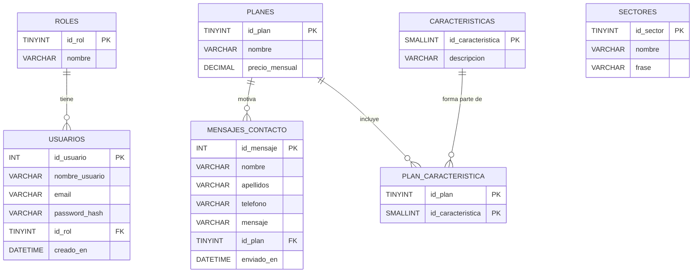

# 3. Diagrama de la base de datos

## Diagrama entidad-relación



`SECTORES` no tiene relaciones: son contenido fijo de la web. Los **ataques capturados no se guardan en esta base de datos**: los registra Wazuh y los muestra Grafana, y la web solo incrusta esos paneles.

## Reflexiones de diseño

**¿Qué datos son estrictamente necesarios?** Los que muestra o recibe la web: planes con sus características, sectores, mensajes del formulario de contacto y la cuenta del administrador. Los ataques los ve el administrador en los paneles de Grafana. No se guardan datos que no se usen.

**¿Qué tipos de usuarios o roles hay y qué datos se recopilan?**

| Rol | Datos que se guardan |
|---|---|
| Visitante (sin login) | Solo lo que escribe en el formulario de contacto: nombre, apellidos, teléfono y mensaje. |
| Administrador | Nombre de usuario, email y contraseña. |

**¿Qué tipo de dato es el óptimo para cada campo?**

| Tabla | Campo | Tipo | Motivo |
|---|---|---|---|
| roles | id_rol | TINYINT UNSIGNED | Habrá muy pocos roles. |
| roles | nombre | VARCHAR(30) | Nombre corto y único. |
| usuarios | id_usuario | INT UNSIGNED | Clave autonumérica. |
| usuarios | nombre_usuario | VARCHAR(50) UNIQUE | Límite de longitud y sin duplicados. |
| usuarios | email | VARCHAR(100) UNIQUE | Longitud razonable para un email. |
| usuarios | password_hash | VARCHAR(255) | Espacio suficiente para un hash bcrypt o argon2id. |
| planes | precio_mensual | DECIMAL(8,2) | Dinero con exactitud, sin errores de coma flotante. |
| planes | nombre | VARCHAR(50) | Nombre del plan. |
| caracteristicas | descripcion | VARCHAR(150) | Una línea de la lista de lo que incluye cada plan. |
| sectores | nombre / frase | VARCHAR(50) / VARCHAR(200) | Texto corto de cada tarjeta. |
| mensajes_contacto | nombre / apellidos | VARCHAR(50) / VARCHAR(100) | Límite de longitud por seguridad. |
| mensajes_contacto | telefono | VARCHAR(20) | Admite prefijo internacional y espacios. |
| mensajes_contacto | mensaje | VARCHAR(1000) | Límite de caracteres para evitar abusos. |
| mensajes_contacto | enviado_en | DATETIME | Fecha y hora del envío. |

**¿Están las tablas normalizadas?** Sí, hasta tercera forma normal: cada campo depende solo de su clave y no hay datos repetidos. La relación **N:M** entre planes y características se resuelve con la tabla intermedia `plan_caracteristica`, cuya clave primaria es la pareja (`id_plan`, `id_caracteristica`). Así, una característica como «Soporte 24/7» se escribe una sola vez aunque pertenezca a varios planes.

## Script de creación

```sql
CREATE DATABASE honeypot_web CHARACTER SET utf8mb4 COLLATE utf8mb4_unicode_ci;
USE honeypot_web;

CREATE TABLE roles (
  id_rol TINYINT UNSIGNED AUTO_INCREMENT PRIMARY KEY,
  nombre VARCHAR(30) NOT NULL UNIQUE
);

CREATE TABLE usuarios (
  id_usuario INT UNSIGNED AUTO_INCREMENT PRIMARY KEY,
  nombre_usuario VARCHAR(50) NOT NULL UNIQUE,
  email VARCHAR(100) NOT NULL UNIQUE,
  password_hash VARCHAR(255) NOT NULL,
  id_rol TINYINT UNSIGNED NOT NULL,
  creado_en DATETIME NOT NULL DEFAULT CURRENT_TIMESTAMP,
  FOREIGN KEY (id_rol) REFERENCES roles(id_rol)
);

CREATE TABLE planes (
  id_plan TINYINT UNSIGNED AUTO_INCREMENT PRIMARY KEY,
  nombre VARCHAR(50) NOT NULL,
  precio_mensual DECIMAL(8,2) NOT NULL
);

CREATE TABLE caracteristicas (
  id_caracteristica SMALLINT UNSIGNED AUTO_INCREMENT PRIMARY KEY,
  descripcion VARCHAR(150) NOT NULL
);

CREATE TABLE plan_caracteristica (
  id_plan TINYINT UNSIGNED NOT NULL,
  id_caracteristica SMALLINT UNSIGNED NOT NULL,
  PRIMARY KEY (id_plan, id_caracteristica),
  FOREIGN KEY (id_plan) REFERENCES planes(id_plan),
  FOREIGN KEY (id_caracteristica) REFERENCES caracteristicas(id_caracteristica)
);

CREATE TABLE sectores (
  id_sector TINYINT UNSIGNED AUTO_INCREMENT PRIMARY KEY,
  nombre VARCHAR(50) NOT NULL,
  frase VARCHAR(200) NOT NULL
);

CREATE TABLE mensajes_contacto (
  id_mensaje INT UNSIGNED AUTO_INCREMENT PRIMARY KEY,
  nombre VARCHAR(50) NOT NULL,
  apellidos VARCHAR(100) NOT NULL,
  telefono VARCHAR(20) NOT NULL,
  mensaje VARCHAR(1000) NOT NULL,
  id_plan TINYINT UNSIGNED NULL,
  enviado_en DATETIME NOT NULL DEFAULT CURRENT_TIMESTAMP,
  FOREIGN KEY (id_plan) REFERENCES planes(id_plan)
);
```

[← Arquitectura del software](README.md)
