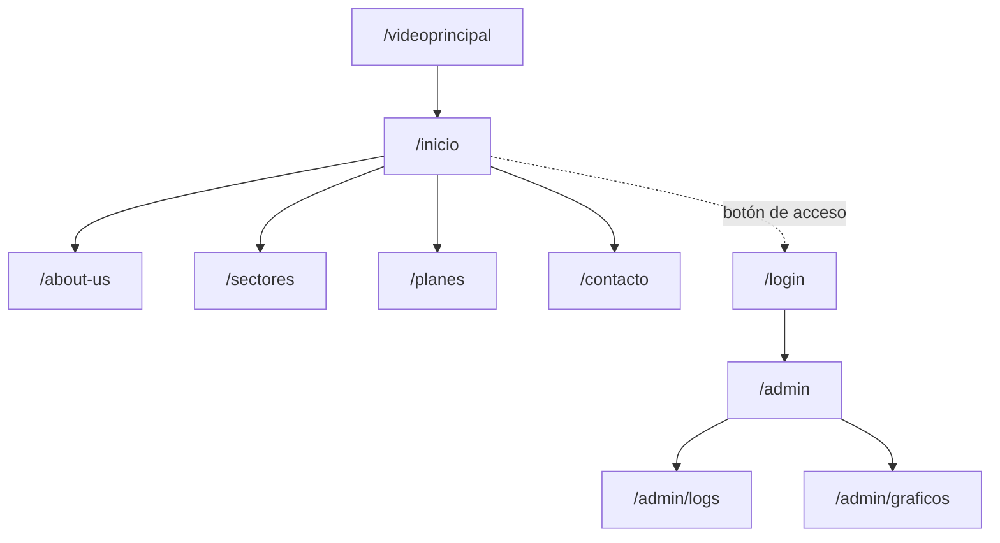

# 4. Desarrollo y diseño UI/UX

## Mapa de navegabilidad



Se entra por un vídeo de presentación que lleva a Inicio, y desde Inicio se llega al resto de páginas. La barra de navegación se repite en todas las páginas públicas, de modo que desde cualquiera se puede ir a las demás.

> [!NOTE]
> El diseño de las páginas públicas del sitio está documentado en [Diseño y plan de producción](../parte-web/diseno-y-plan-de-produccion.md). El acceso de administrador (`/login` y `/admin`) se añade en esta arquitectura.

## Roles de usuario

| Rol | Acceso | Qué puede hacer |
|---|---|---|
| **Visitante** | Público, sin login | Ver el vídeo, Inicio, Sobre nosotros, Sectores y Planes, y enviar el formulario de contacto. |
| **Administrador** | Login con usuario y contraseña | Todo lo anterior, más el panel con los logs de los ataques y los gráficos de Grafana. |

## Qué hace cada elemento de la interfaz

| Pantalla | Elementos | Qué hace cada elemento |
|---|---|---|
| `/videoprincipal` | Vídeo a pantalla completa sobre fondo negro | Explica qué es un honeypot y qué ofrece la empresa; al terminar redirige solo a Inicio. |
| `/inicio` | Barra de navegación, bloque de texto con imagen y dos botones | El logo vuelve a Inicio; los enlaces llevan a Sobre nosotros, Sectores, Planes y Contacto; los dos botones llevan a Planes y a Contacto. |
| `/about-us` | Título y cuadro de texto | Describe quiénes somos, a qué nos dedicamos y por qué usamos honeypots. |
| `/sectores` | Título, texto introductorio y 4 tarjetas | Cada tarjeta presenta un sector y puede llevar a Contacto. |
| `/planes` | Título y 3 tarjetas | Cada plan muestra su nombre, precio mensual y lo que incluye; su botón lleva a Contacto. |
| `/contacto` | Formulario sobre un recuadro oscuro | Recoge nombre, apellidos, teléfono y mensaje; al enviar guarda el mensaje y muestra una confirmación; con campos vacíos avisa del error. |
| `/login` | Formulario de usuario y contraseña | Valida las credenciales e inicia la sesión; si fallan, muestra un error genérico. |
| `/admin` | Panel con dos pestañas y botón de cerrar sesión | Da acceso a los logs y a los gráficos; cerrar sesión devuelve a Inicio. |
| `/admin/logs` | Tabla de ataques | Panel de Grafana incrustado con fecha, IP de origen, honeypot, protocolo y usuario probado; los datos vienen de Wazuh. |
| `/admin/graficos` | Gráficos incrustados | Muestra los dashboards de Grafana con las estadísticas de los ataques. |

## Bocetos y wireframes

Los bocetos están hechos en Figma, con la web [tworockets.consulting](https://www.tworockets.consulting/) como referencia de estilo:

- [Mockup en Figma](https://www.figma.com/design/2hHxSq9MufPYlfE1gnFww0)

Las notas de cada pantalla (elementos, navegación y datos que se muestran) están en [Diseño y plan de producción](../parte-web/diseno-y-plan-de-produccion.md).

## Desarrollo web

- **Frontend responsive** con Bootstrap 5.3 y algo de CSS propio para el estilo.
- **Backend en PHP 8.4** que conecta con la base de datos mediante PDO.
- **nginx** apunta a la carpeta `public`; el código y las credenciales quedan fuera de ella.
- **Logs y gráficos:** son paneles de Grafana incrustados en `/admin`, servidos a través de un proxy de nginx (ver [Seguridad](6.-seguridad.md)). La web no lee los ataques de su propia base de datos.

```
/var/www/honeypot.lan/
  public/        raíz que sirve nginx
    index.php
    assets/      css, js, imágenes y vídeo
  src/           lógica PHP
  .env           credenciales de la base de datos
```

## Calidad de la base de datos

- El diseño E-R de [Diagrama de la base de datos](3.-diagrama-de-la-base-de-datos.md) se implementa tal cual en la base de datos real.
- Cada campo usa el tipo adecuado y un límite de caracteres, por seguridad.
- La relación N:M entre planes y características usa una tabla intermedia.

## Control de versiones

- **Git** para el código y **GitHub** para el repositorio remoto y la documentación del proyecto.
- Rama `main` estable y ramas por funcionalidad que se integran al terminarlas.
- Commits pequeños con mensaje descriptivo.

[← Arquitectura del software](README.md)
