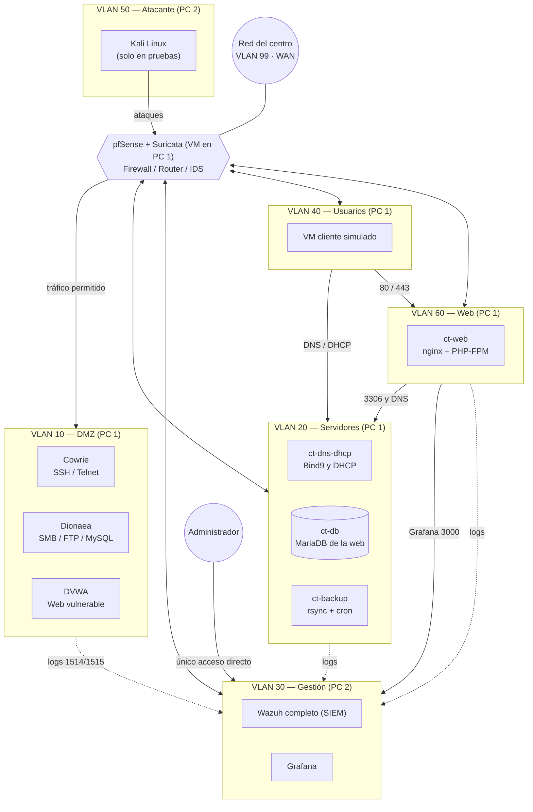

# Diagrama de red

## Introducción

Esquema general de la arquitectura de **HoneyNet**: dos PCs con **Proxmox** (el PC 1 con pfSense + Suricata en una VM, honeypots, servidores, web y usuario; el PC 2 con el SIEM y Kali), un switch **HP 1810-24**, seis VLANs internas más la WAN y el flujo de tráfico permitido entre ellas. El hardware se detalla en [Infraestructura física](infraestructura-fisica.md) y el direccionamiento en [Infraestructura y red (Proxmox)](arquitectura-del-software/5.-infraestructura-y-red-proxmox.md).

---

## Esquema general

---

## Reglas de tráfico

| Origen | Destino | ¿Permitido? | Motivo |
|---|---|---|---|
| Atacante (Kali, VLAN 50) | DMZ, vía pfSense | ✅ Sí | Es el tráfico que el proyecto busca atraer y capturar |
| Atacante | Web | ✅ Solo 80 y 443 | Probar el sitio de la empresa |
| Atacante | Servidores / Gestión / Usuarios | ❌ No | pfSense nunca expone directamente las VLANs internas |
| DMZ | Gestión | ✅ Solo logs (1514/1515, un sentido) | Monitorización, no es tráfico de ataque |
| DMZ | Resto de VLANs | ❌ No | Si un honeypot se compromete, debe quedar aislado. No necesita base de datos: los ataques los guarda Wazuh |
| Servidores | Gestión | ✅ Solo logs | Igual que el caso anterior |
| Web | Servidores | ✅ Solo `ct-db` (3306) y DNS (53) | La web consulta su base de datos y resuelve nombres |
| Web | Gestión | ✅ Grafana (3000) y logs (1514/1515) | Proxy de `/grafana/` para el panel de administración y agente de logs |
| Usuarios | Servidores | ✅ DNS y DHCP | Consumo normal de los servicios internos |
| Usuarios | Web | ✅ Solo 80 y 443 | Visitar la web de la empresa |
| Usuarios | DMZ / Gestión | ❌ No | Los empleados simulados no tienen motivo para tocar esas VLANs |
| Administrador | Gestión | ✅ Único acceso directo | Es la VLAN más protegida de todas |

El detalle de las reglas de pfSense y de UFW está en [Seguridad](arquitectura-del-software/6.-seguridad.md).

[← Volver a Introducción](README.md)
