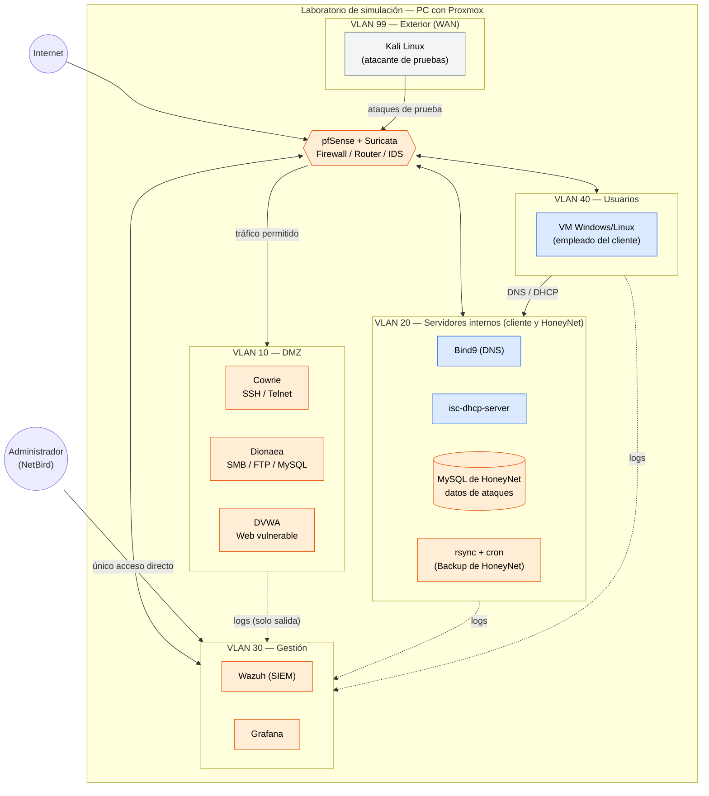

# Diagrama de red

## Introducción

Esquema general de la arquitectura de **HoneyNet**: la red del cliente, segmentada en cinco VLANs por un firewall con detección de intrusiones, y el flujo de tráfico permitido entre ellas.

Todo ello se simula dentro de un **laboratorio**: un único PC con **Proxmox** que representa la infraestructura del cliente. En un cliente real, la red ya existiría; lo que aporta HoneyNet es la segmentación, el firewall, los señuelos y la monitorización.

---

## Esquema general

### Leyenda

| Color | Rol | Significado |
|---|---|---|
| 🟧 Naranja | **HoneyNet** | Lo que implanta la empresa en el cliente |
| 🟦 Azul | **Cliente** | La infraestructura del cliente (simulada) |
| ⬜ Gris | **Laboratorio** | Solo existe para simular el escenario |

> La zona de servidores internos es mixta: DNS y DHCP son del cliente; la base de datos y las copias de seguridad son de HoneyNet.

---

## Reglas de tráfico

| Origen | Destino | ¿Permitido? | Motivo |
|---|---|---|---|
| Exterior (Kali / Internet) | DMZ, vía pfSense | ✅ Sí | Es el tráfico que el proyecto busca atraer y capturar |
| Exterior (Kali / Internet) | Servidores / Gestión / Usuarios | ❌ No | pfSense nunca expone directamente las VLANs internas al exterior |
| DMZ | Cualquier otra VLAN | ❌ No (salvo logs) | Si un honeypot se compromete, debe quedar aislado |
| DMZ | Gestión | ✅ Solo logs (un sentido) | Monitorización, no es tráfico de ataque |
| Servidores | Gestión | ✅ Solo logs | Igual que el caso anterior |
| Usuarios | Servidores | ✅ Sí | Consumo normal de DNS/DHCP |
| Usuarios | DMZ / Gestión | ❌ No | Los empleados del cliente no tienen motivo para tocar esas VLANs |
| Administrador (NetBird) | Gestión | ✅ Único acceso directo | Es la VLAN más protegida de todas |

[← Introducción](README.md)
