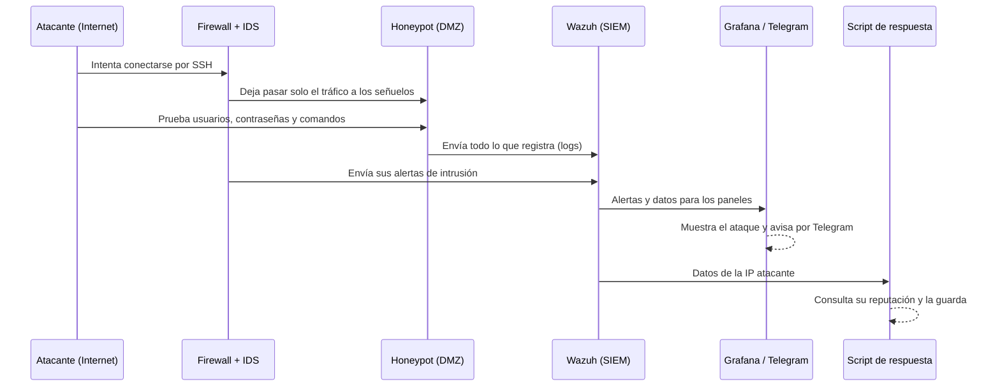
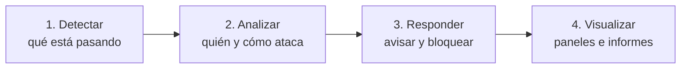
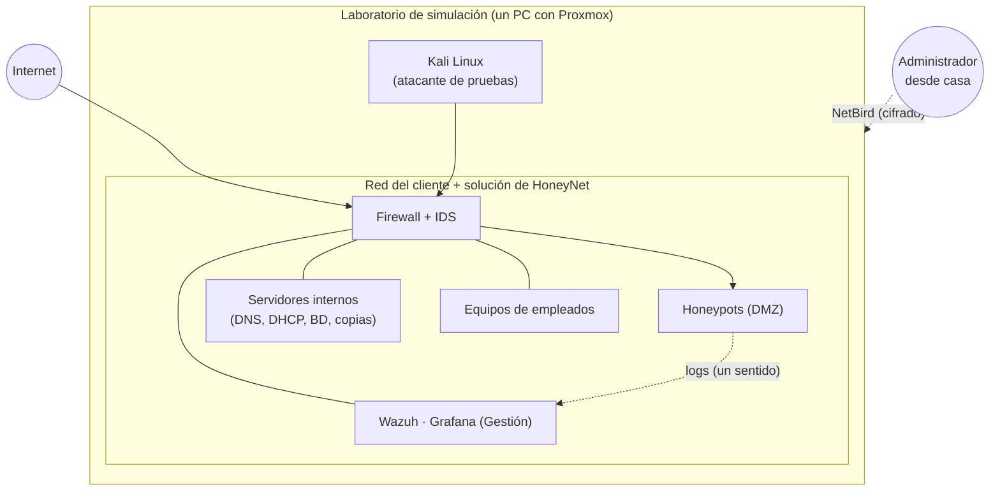

# La idea principal

Esta página explica el proyecto completo de forma sencilla: qué es **HoneyNet**, qué servicio ofrece y cómo lo simulamos en un laboratorio. Si solo vas a leer una página de este repositorio, que sea esta.

## 1. El proyecto en una frase

> **HoneyNet** es una empresa (ficticia) que **implanta honeypots en otras empresas, los mantiene y les entrega informes** de lo que ocurre. Este proyecto documenta cómo lo hacemos para un cliente concreto, usando un laboratorio que simula su red.

## 2. Qué es HoneyNet y qué ofrece

HoneyNet se dedica a la **ciberseguridad defensiva**. Su servicio tiene tres pilares, porque al cliente no se le cobra solo por instalar algo, sino por tenerlo funcionando y por entender lo que pasa:

| Pilar | Qué significa |
|---|---|
| **Implantar** | Diseñar y desplegar en la red del cliente una zona de señuelos (honeypots) y las herramientas para vigilarla. |
| **Mantener** | Mantener todo funcionando: actualizaciones, copias de seguridad, restaurar señuelos y revisar alertas. |
| **Reportar** | Entregar al cliente un informe completo: qué ataques recibe, de dónde vienen y qué técnicas usan. |

### ¿Por qué querría una empresa algo así?

Cualquier equipo conectado a Internet recibe intentos de ataque constantemente, en su mayoría de **programas automáticos** que recorren la red probando contraseñas y buscando servicios vulnerables. En una empresa normal esos ataques se bloquean y se olvidan: se sabe poco sobre **quién ataca, qué prueba y cómo lo hace**.

Un **honeypot** ("tarro de miel") da la vuelta a esa idea: es un sistema **diseñado para ser atacado**. No guarda nada valioso ni lo usa nadie, así que cualquier visita que recibe es sospechosa y todo lo que hace el atacante se puede observar y registrar sin ruido. Para el cliente eso significa:

- **Visibilidad:** saber qué ataques recibe de verdad.
- **Alerta temprana:** si alguien toca un señuelo, hay un problema que investigar.
- **Datos para decidir:** qué proteger primero, según lo que realmente le intentan.

> **Analogía:** una cartera falsa a la vista, con una cámara escondida. No importa lo que haya dentro; importa quién la coge y cómo lo intenta.

## 3. Qué hace HoneyNet en la red del cliente

El cliente ya tiene su propia red, como cualquier pyme: servidores internos (**DNS y DHCP**) y los equipos de sus **empleados**.

Sobre esa red, HoneyNet implanta su solución:

1. **Segmenta la red** en zonas aisladas (VLANs), para que lo que se ataque no pueda llegar a lo que hay que proteger.
2. **Instala un firewall con detección de intrusiones** que controla el tráfico entre zonas.
3. **Crea una zona de señuelos (DMZ)** expuesta a Internet, con los honeypots.
4. **Crea una zona de gestión**, invisible desde fuera, con las herramientas de vigilancia y análisis (Wazuh y Grafana).
5. **Monta su propia base de datos** (donde guarda los datos de los ataques) y sus **copias de seguridad**.
6. **Automatiza** la recogida de logs, las alertas, los paneles y la respuesta.
7. **Se conecta a distancia** de forma segura para administrarlo todo, sin abrir puertos de administración a Internet (con NetBird).
8. **Mantiene** el entorno y **reporta** al cliente.

> El nombre de la empresa cliente aún no está definido. En la documentación se la llama simplemente "la empresa cliente".

## 4. Cómo funciona: la historia de un ataque

Para entenderlo, sigamos a un atacante desde que llega hasta que el cliente ve su rastro:

En palabras:

1. **El atacante llega.** Ve un servidor SSH abierto y empieza a probar contraseñas.
2. **El firewall** solo deja pasar el tráfico hacia los señuelos. El resto de la red del cliente queda fuera de su alcance. Un sistema de detección (IDS) vigila el tráfico y genera alertas.
3. **El honeypot responde** como si fuera un servidor real. El atacante cree que entra en un sistema, pero está en una **jaula**: cada intento, usuario, contraseña y comando queda grabado.
4. **Los registros viajan** a una zona separada, donde un SIEM (Wazuh) los reúne y los analiza.
5. **Se ve el resultado:** paneles con gráficos y mapas de dónde vienen los ataques, y avisos al móvil por Telegram.
6. **Un script responde:** consulta si esa IP ya es conocida por hacer daño, la guarda en una base de datos y, si el proyecto llega a esa fase, puede bloquearla.

## 5. Las piezas de la red

La red se divide en **zonas** (VLANs) aisladas entre sí, cada una con reglas claras sobre qué puede comunicarse con qué:

| Zona | Qué hay | Quién la pone | Para qué |
|---|---|---|---|
| **Exterior (WAN)** | Lo que llega desde Internet | — | El origen de los ataques |
| **DMZ** | Los honeypots | HoneyNet | Es lo único que el atacante puede alcanzar |
| **Servidores internos** | DNS y DHCP del cliente; base de datos y copias de seguridad de HoneyNet | Cliente y HoneyNet | Infraestructura de red del cliente, más la base de datos propia de HoneyNet donde se guardan los datos de los ataques |
| **Gestión** | Wazuh y Grafana | HoneyNet | Vigilar y analizar; es la zona más protegida |
| **Usuarios** | Equipos de los empleados | Cliente | La plantilla del cliente |

La regla de oro: **si un honeypot se compromete, el atacante queda atrapado en la DMZ**. No puede llegar a la zona de gestión ni a los servidores del cliente. Solo se permite que los señuelos envíen sus registros hacia fuera, en un único sentido.

Los detalles de las reglas están en el [diagrama de red](diagrama-de-red.md).

## 6. Los señuelos

Cada honeypot atrae un tipo de ataque distinto:

| Señuelo | Qué simula | Qué aprendemos |
|---|---|---|
| **Cowrie** | Un servidor SSH/Telnet | Qué usuarios y contraseñas prueban, y qué comandos ejecutan al "entrar" |
| **Dionaea** | Servicios vulnerables (SMB, FTP, bases de datos...) | Qué **malware** intenta propagarse; lo captura para estudiarlo |
| **DVWA** | Una web deliberadamente vulnerable | Cómo se atacan las aplicaciones web (inyección SQL, fuerza bruta...) |

Cada uno se ejecuta en un **contenedor Docker**, de modo que se pueden levantar, parar y renovar con facilidad.

## 7. El ciclo completo, con las herramientas

El servicio no se limita a poner trampas: cierra el círculo completo.

| Paso | Qué hace | Herramientas |
|---|---|---|
| **Detectar** | Ver el tráfico sospechoso y los intentos de ataque | Firewall con IDS (Suricata) y los propios honeypots |
| **Analizar** | Reunir todos los registros y relacionarlos | Wazuh (SIEM) |
| **Responder** | Avisar y, cuando es posible, bloquear al atacante | Telegram, script en Python, AbuseIPDB |
| **Visualizar** | Entender de un vistazo qué está pasando | Grafana (paneles y mapa de atacantes) |

Gran parte del trabajo técnico del proyecto es **automatizar** este ciclo: que los registros se recojan, se analicen y se conviertan en alertas y paneles sin intervención manual.

## 8. Mantener: que siga funcionando

Un honeypot sin mantenimiento deja de ser útil, o peor, se vuelve un riesgo. Por eso el servicio incluye mantener el entorno:

- **Actualizar** el sistema, las imágenes Docker y las reglas de detección.
- **Copias de seguridad** automáticas y comprobación de que se pueden restaurar.
- **Restaurar** un honeypot comprometido a un estado limpio.
- **Revisar las alertas** y ajustar las reglas para reducir falsos positivos.
- **Vigilar** que todo está en marcha, el espacio en disco y los accesos.

Más detalle en la página de teoría [Mantenimiento y reportes](../Teoria/mantenimiento-y-reportes.md).

## 9. Reportar: lo que recibe el cliente

Parte esencial del servicio es entregar al cliente un **reporte completo** de lo que ocurre en su red. Un informe típico incluye:

- **Resumen** del periodo, comprensible sin conocimientos técnicos.
- **Los ataques más recibidos:** qué servicios, qué técnicas.
- **De dónde vienen:** IPs y países más frecuentes.
- **Qué intentan:** credenciales más probadas, comandos ejecutados, malware capturado.
- **Evolución** frente a periodos anteriores.
- **Estado del sistema** y tareas de mantenimiento realizadas.
- **Recomendaciones** para el cliente según lo observado.

## 10. Seguridad: que los señuelos no sean un peligro

Un honeypot es peligroso si se hace mal, así que el diseño parte de varias precauciones:

- **Aislamiento por zonas:** los señuelos no tienen acceso al resto de la red del cliente.
- **Mínimos privilegios:** cada zona solo puede comunicarse con lo estrictamente necesario.
- **Vigilar la salida:** lo que sale de un honeypot se limita y se registra, para que no sirva para atacar a otros.
- **Poder restaurar:** si un señuelo se compromete, se vuelve a un estado limpio en segundos.
- **Administración sin puertos abiertos:** HoneyNet administra la infraestructura a distancia con **NetBird**, una red privada cifrada.
- **Prueba antes de exponer:** primero se ataca la red desde dentro con un atacante de pruebas, y solo después se abre a Internet de forma controlada.

## 11. Cómo lo simulamos: el laboratorio

Como no tenemos un cliente real, **simulamos su red en un laboratorio**. Esta distinción es importante:

- **El servicio de HoneyNet** (segmentar, firewall, honeypots, monitorización, automatización, mantenimiento e informes) es **lo que se vendería a un cliente real**.
- **El laboratorio** es solo el **escenario** donde lo demostramos. En un cliente real, su infraestructura ya existiría; aquí la creamos nosotros.

El laboratorio es **un único PC con Proxmox**, situado en el aula, que permite tener muchas máquinas virtuales a la vez, cada una aislada de las demás. Dentro hay tres tipos de cosas:

| Qué | Para qué | A quién pertenece |
|---|---|---|
| **Red simulada del cliente** | DNS, DHCP y equipos de empleados | Cliente (simulado) |
| **Solución de HoneyNet** | Firewall, honeypots, Wazuh, Grafana | HoneyNet (lo real del proyecto) |
| **Atacante de pruebas (Kali Linux)** | Generar ataques controlados antes de exponer el sistema | Laboratorio |

Desde casa se accede al laboratorio mediante NetBird.

Como todo el laboratorio vive en **un solo PC**, también hacemos **copias de seguridad del propio proyecto** (máquinas virtuales, configuraciones y documentación), para no perder el trabajo si falla el equipo. Estas copias son aparte de las del servicio: protegen el proyecto de los estudiantes, no los datos de un cliente.

## 12. En qué se centra el proyecto

La mayor parte del trabajo, y de esta documentación, es el servicio de HoneyNet:

1. **Implantar:** segmentar la red, instalar el firewall y desplegar los honeypots con Docker.
2. **Recoger y analizar los logs** con un SIEM y guardarlos en una base de datos propia.
3. **Automatizar** alertas, paneles, copias y respuesta.
4. **Mantener y reportar:** cómo se opera el entorno y qué se entrega al cliente.

Y, como base, **montar el laboratorio** que simula la red del cliente.

La parte comercial de la empresa (servicios, modelo de negocio, precios) se documentará más adelante.

## 13. Cómo está organizada la documentación

- **[Objetivos](objetivos-del-proyecto.md):** qué queremos conseguir exactamente.
- **[Stack tecnológico](stack-tecnologico.md):** las herramientas que se usan y a quién pertenece cada una.
- **[Diagrama de red](diagrama-de-red.md):** la arquitectura y las reglas de tráfico.
- **[Teoría](../Teoria/README.md):** explicación de cada tecnología, primero en simple y luego en técnico.

[← Volver a Introducción](README.md)
