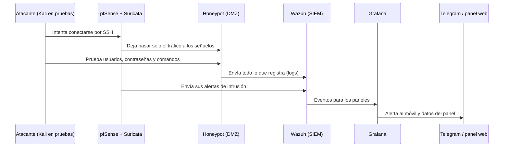
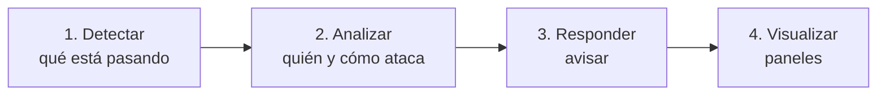

# La idea principal

Esta página explica el proyecto completo de forma sencilla: qué es **HoneyNet**, qué servicio ofrece y cómo lo montamos en un laboratorio. Si solo vas a leer una página de este repositorio, que sea esta.

## 1. El proyecto en una frase

> **HoneyNet** es una empresa (ficticia) que **vende un servicio de honeypots**: los implanta en la red de otras empresas, los mantiene y les enseña lo que ocurre. Este proyecto documenta cómo lo montamos en una **red de empresa simulada**, la nuestra.

## 2. Qué es HoneyNet y qué ofrece

HoneyNet se dedica a la **ciberseguridad defensiva**. Su servicio tiene tres pilares, porque al cliente no se le cobra solo por instalar algo, sino por tenerlo funcionando y por entender lo que pasa:

| Pilar | Qué significa |
|---|---|
| **Implantar** | Diseñar y desplegar en la red del cliente una zona de señuelos (honeypots) y las herramientas para vigilarla. |
| **Mantener** | Mantener todo funcionando: actualizaciones, copias de seguridad, restaurar señuelos y revisar alertas. |
| **Reportar** | Enseñar al cliente qué ataques recibe, de dónde vienen y qué técnicas usan. |

Estos pilares se reflejan en los **planes de la web de la empresa**:

| Plan | Precio | Incluye |
|---|---|---|
| **Esencial** | 49 €/mes | 1 honeypot, informe mensual y sin permanencia |
| **Profesional** | 149 €/mes | 3 honeypots, panel de ataques y alertas en tiempo real |
| **Empresa** | A consultar | Honeypots a medida, soporte continuo e informes personalizados |

### ¿Por qué querría una empresa algo así?

Cualquier equipo conectado a Internet recibe intentos de ataque constantemente, en su mayoría de **programas automáticos** que recorren la red probando contraseñas y buscando servicios vulnerables. En una empresa normal esos ataques se bloquean y se olvidan: se sabe poco sobre **quién ataca, qué prueba y cómo lo hace**.

Un **honeypot** ("tarro de miel") da la vuelta a esa idea: es un sistema **diseñado para ser atacado**. No guarda nada valioso ni lo usa nadie, así que cualquier visita que recibe es sospechosa y todo lo que hace el atacante se puede observar y registrar sin ruido. Para el cliente eso significa:

- **Visibilidad:** saber qué ataques recibe de verdad.
- **Alerta temprana:** si alguien toca un señuelo, hay un problema que investigar.
- **Datos para decidir:** qué proteger primero, según lo que realmente le intentan.

> **Analogía:** una cartera falsa a la vista, con una cámara escondida. No importa lo que haya dentro; importa quién la coge y cómo lo intenta.

## 3. El caso del proyecto: una empresa simulada

Como no tenemos un cliente real, **simulamos la red de una empresa**. Esa empresa tiene lo que tendría cualquier pyme:

- **Servidores internos:** DNS, DHCP, una base de datos y copias de seguridad.
- **Una web pública** (la de HoneyNet), con vídeo de presentación, sectores, planes y formulario de contacto, y una zona de administración con login.
- **Un equipo de empleado** (una VM con navegador).

Sobre esa red, HoneyNet añade su solución:

1. **Segmenta la red** en zonas aisladas (VLANs) con un switch gestionable.
2. **Instala un firewall con detección de intrusiones** (pfSense con Suricata) que controla el tráfico entre zonas.
3. **Crea una zona de señuelos (DMZ)** con los honeypots, aislada del resto.
4. **Crea una zona de gestión** con las herramientas de vigilancia y análisis: Wazuh y Grafana.
5. **Configura alertas** que llegan al móvil por Telegram, sin escribir código.
6. **Muestra los ataques** al administrador en el panel de la web, con login.
7. **Permite administrar a distancia** el laboratorio de forma cifrada (con NetBird).

## 4. Cómo funciona: la historia de un ataque

Para entenderlo, sigamos a un atacante desde que llega hasta que el administrador ve su rastro:

En palabras:

1. **El atacante llega.** Ve un servidor SSH abierto y empieza a probar contraseñas. En el laboratorio es Kali Linux, en su propia zona aislada.
2. **El firewall** solo deja pasar el tráfico hacia los señuelos. El resto de la red queda fuera de su alcance. Un sistema de detección (IDS) vigila el tráfico y genera alertas.
3. **El honeypot responde** como si fuera un servidor real. El atacante cree que entra en un sistema, pero está en una **jaula**: cada intento, usuario, contraseña y comando queda grabado.
4. **Los registros viajan** a la zona de gestión, donde Wazuh los reúne y los analiza. **Los ataques se guardan en Wazuh**, no en la base de datos de la web.
5. **Se ve el resultado:** Grafana muestra gráficos y una tabla de logs, que el administrador ve dentro del panel de la web.
6. **Llega el aviso:** Grafana manda una alerta al móvil por Telegram cuando ocurre algo importante (por ejemplo, muchos logins fallidos o malware descargado).

## 5. Las piezas de la red

La red se divide en **seis zonas internas (VLANs)** más la salida hacia el exterior, aisladas entre sí. Cada una tiene reglas claras sobre qué puede comunicarse con qué:

| VLAN | Zona | Qué hay |
|---|---|---|
| **99** | Exterior (WAN) | La salida hacia la red del centro |
| **10** | DMZ | Los honeypots |
| **20** | Servidores | DNS, DHCP, base de datos y copias de seguridad |
| **30** | Gestión | Wazuh y Grafana, y la administración |
| **40** | Usuarios | El equipo de un empleado |
| **50** | Atacante | Kali Linux, para las pruebas |
| **60** | Web | El servidor web de la empresa |

La regla de oro: **si un honeypot se compromete, el atacante queda atrapado en la DMZ**. Desde ahí solo se permite enviar los logs a Wazuh, en un único sentido, y todo lo demás está bloqueado. Además, la web va en su **propia VLAN** porque es un servicio real y no debe convivir con unos señuelos que están ahí para ser atacados.

Los detalles de las reglas y el direccionamiento están en el [diagrama de red](diagrama-de-red.md).

## 6. Los señuelos

Cada honeypot atrae un tipo de ataque distinto:

| Señuelo | Qué simula | Qué aprendemos |
|---|---|---|
| **Cowrie** | Un servidor SSH/Telnet | Qué usuarios y contraseñas prueban, y qué comandos ejecutan al "entrar" |
| **Dionaea** | Servicios vulnerables (SMB, FTP, MySQL...) | Qué **malware** intenta propagarse; lo captura para estudiarlo |
| **DVWA** | Una web deliberadamente vulnerable | Cómo se atacan las aplicaciones web (inyección SQL, fuerza bruta...) |

Se ejecutan con **Docker** en una VM de la DMZ, de modo que se pueden levantar, parar y renovar con facilidad.

## 7. El ciclo completo, con las herramientas

El servicio no se limita a poner trampas: cierra el círculo completo.

| Paso | Qué hace | Herramientas |
|---|---|---|
| **Detectar** | Ver el tráfico sospechoso y los intentos de ataque | Firewall con IDS (Suricata) y los propios honeypots |
| **Analizar** | Reunir todos los registros y relacionarlos | Wazuh (SIEM) y sus reglas |
| **Responder** | Avisar al instante | Alertas de Grafana a Telegram, sin código |
| **Visualizar** | Entender de un vistazo qué está pasando | Grafana: paneles, mapa y tabla de logs |

Como **extra opcional**, si sobra tiempo, se podría bloquear automáticamente las IPs atacantes en el firewall con un script.

## 8. Mantener y reportar

Un honeypot sin mantenimiento deja de ser útil, o peor, se vuelve un riesgo. Por eso el servicio incluye mantener el entorno (actualizar, copias de seguridad nocturnas, restaurar un honeypot comprometido, revisar alertas) y **reportar** al cliente lo que ocurre. Más detalle en la teoría de [Mantenimiento y reportes](../Teoria/mantenimiento-y-reportes.md).

> Las direcciones IP de los atacantes son **datos personales** a efectos del RGPD. En los informes y la memoria conviene **anonimizarlas** (por ejemplo, ocultando el último octeto).

## 9. Seguridad: que los señuelos no sean un peligro

Un honeypot es peligroso si se hace mal, así que el diseño parte de varias precauciones:

- **Aislamiento por zonas:** los señuelos no tienen acceso al resto de la red.
- **Solo una puerta de salida:** desde la DMZ solo se permite enviar los logs a Wazuh (puertos 1514 y 1515). La DMZ **no necesita base de datos**, porque los ataques los guarda Wazuh.
- **Mínimo privilegio en cada servidor:** cada uno tiene su cortafuegos (UFW) y solo abre lo que necesita; la base de datos solo acepta a la web.
- **SSH solo con claves** y solo desde la zona de gestión.
- **Zona de administración protegida:** el panel de la web y Grafana solo se alcanzan desde la red interna.
- **El atacante de pruebas está aislado:** Kali vive en su propia zona y solo alcanza los puertos de los honeypots y de la web.
- **Poder restaurar:** si un señuelo se compromete, se vuelve a un estado limpio con snapshots.

## 10. El laboratorio: hardware real y limitado

El laboratorio usa **material del centro**, que no se puede ampliar:

| Equipo | Función |
|---|---|
| **PC 1 (Proxmox)** | pfSense + Suricata (VM), honeypots, servidores, web y cliente. 8 GB de RAM y SSD de 128 GB. |
| **PC 2 (Proxmox)** | El SIEM (Wazuh y Grafana) y Kali. |
| **Switch HP 1810-24** | Conecta los dos PCs y reparte las VLANs. |

Esa limitación de memoria explica varias decisiones de diseño: servidores en **contenedores LXC** ligeros, nginx en lugar de un servidor más pesado, y **dos Proxmox independientes** sin clúster. Cada PC tiene una sola tarjeta de red, así que pfSense funciona con un único cable (*router on a stick*). Ver [Infraestructura física](infraestructura-fisica.md).

Se trabaja desde casa mediante **NetBird**, una VPN, ya que los equipos están siempre encendidos en el centro.

## 11. Cómo está organizada la documentación

- **[Infraestructura física](infraestructura-fisica.md):** el hardware y las decisiones tomadas.
- **[Diagrama de red](diagrama-de-red.md):** la arquitectura y las reglas de tráfico.
- **[Stack tecnológico](stack-tecnologico.md):** todas las herramientas y su documentación.
- **[Arquitectura del software](arquitectura-del-software/README.md):** requisitos, componentes, base de datos, interfaz, red y seguridad.
- **[Parte web](parte-web/diseno-y-plan-de-produccion.md):** diseño de la web de la empresa.
- **[Objetivos](objetivos-del-proyecto.md):** qué queremos conseguir.
- **[Teoría](../Teoria/README.md):** explicación de cada tecnología, primero en simple y luego en técnico.

[← Volver a Introducción](README.md)
