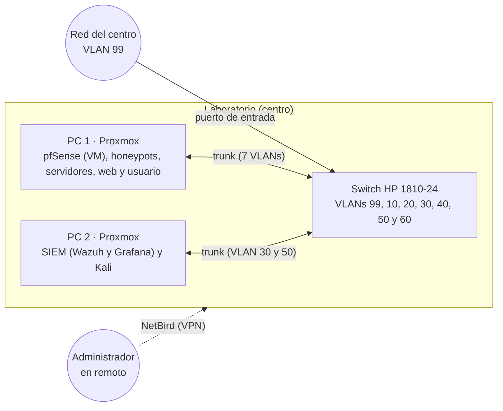
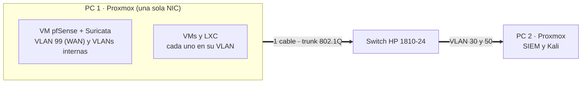
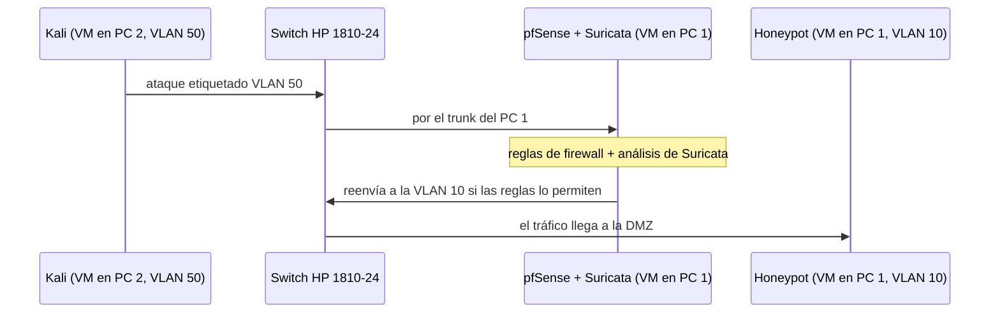

# Infraestructura física

## Introducción

Esta página describe el **hardware real** del laboratorio de HoneyNet: qué equipos se usan, cómo se conectan y qué decisiones se han tomado. Complementa al [Diagrama de red](diagrama-de-red.md), que muestra la arquitectura lógica (VLANs y reglas de tráfico).

---

## Inventario de hardware

| Equipo | Papel en el proyecto | Estado |
|---|---|---|
| **PC 1: Proxmox «honeynet»** | Intel i5-8500 (6 núcleos), 8 GB de RAM y SSD de 128 GB. Aloja la VM de **pfSense + Suricata**, los **honeypots**, los **servidores**, la **web** y la VM de **usuario**. Está siempre encendido. | ✅ En uso |
| **PC 2: antes dedicado a pfSense** | Se reinstala con **Proxmox** y aloja el **SIEM** (Wazuh completo y Grafana) y **Kali**. Tiene una sola tarjeta de red. RAM y disco por confirmar. | 🟡 Pendiente (Fase 1) |
| **Switch HP 1810-24** (J9801A) | Conecta los dos PCs y transporta las VLANs. Se encuentra en el centro. | 🟡 Reservado (se configura en la Fase 2) |
| **Juniper NetScreen-25** (NS-025-005) | Firewall físico prestado por el centro. | ⏸️ Aparcado |

> [!WARNING]
> Los dos PCs, el switch y el firewall son **material del centro**, no propio.

> [!NOTE]
> Cada PC tiene solo **8 GB de RAM y un SSD de 128 GB**, y el centro no puede ampliarlos. De esa limitación sale buena parte de las decisiones de diseño (ver más abajo).

---

## Topología física

---

## Cómo funciona con una sola tarjeta de red

Cada PC tiene **una sola NIC**, y un firewall normalmente necesita al menos dos (una para WAN y otra para LAN). La solución es usar **VLANs sobre un único cable**:

- El PC 1 va conectado al switch en modo **trunk**: por el mismo cable viajan todas las VLANs **etiquetadas** (802.1Q).
- **pfSense es una máquina virtual** del PC 1 con una tarjeta virtual que recibe todas las VLANs. La **VLAN 99** actúa como **WAN** y las VLANs 10, 20, 30, 40, 50 y 60 son las redes internas.
- pfSense crea una interfaz por cada VLAN sobre esa única tarjeta y enruta el tráfico entre ellas.

Esta técnica se conoce como **router on a stick**. Más detalle en la teoría de [VLANs](../Teoria/vlans.md) y [pfSense](../Teoria/pfsense.md).

> [!NOTE]
> **Contrapartida**: todo el tráfico entre VLANs pasa por un único enlace físico. Para un laboratorio es suficiente, pero sería un cuello de botella en una red de producción.

### Recorrido de un ataque

Aunque el honeypot y pfSense estén en el mismo PC, el tráfico entre VLANs siempre tiene que pasar por pfSense:

---

## Reparto de recursos

**PC 1** (unos 7,6 GB de RAM y 54 GB para máquinas)

| Máquina | Tipo | RAM | Disco |
|---|---|---|---|
| Proxmox | Sistema | 1,4 GB | — |
| pfSense con Suricata | VM | 2 GB | 10 GB |
| Honeypots (Docker) | VM | 1 GB | 10 GB |
| Servidores: `ct-dns-dhcp`, `ct-db` y `ct-backup` | 3 LXC | 0,5 GB | 6 GB |
| Web (`ct-web`: nginx + PHP-FPM) | LXC | 0,25 GB | 2 GB |
| Cliente | VM | 1 GB | 10 GB |
| **Total** | | **≈ 6,15 GB** | **≈ 38 GB** |

**PC 2** (suponiendo el mismo hardware que el PC 1)

| Máquina | Tipo | RAM | Disco |
|---|---|---|---|
| Proxmox | Sistema | 1,4 GB | — |
| SIEM (Docker: Wazuh completo y Grafana) | VM | 4 GB | 30 GB |
| Kali (sin escritorio, solo en pruebas) | VM | 1,5-2 GB | 15-20 GB |
| **Total con Kali** | | **≈ 6,9-7,4 GB** | **≈ 45-50 GB** |

---

## Decisiones tomadas

- **Dos Proxmox independientes**, uno por PC, sin clúster. Cada uno gestiona sus máquinas.
- **pfSense + Suricata va en una VM** del PC 1. Antes iba en hardware real, pero el PC dedicado casi no usaba su memoria y la RAM total era insuficiente.
- **Wazuh completo** (manager, indexador y panel) con **Grafana**, en el PC 2, con retención corta de datos. Los ataques se guardan en Wazuh y se ven en Grafana, no en la base de datos de la web.
- **Kali en el PC 2** y encendida solo durante las pruebas. El **cliente** va en el PC 1.
- Servicios internos en **tres contenedores LXC** (DNS y DHCP, base de datos y copias), más uno para la web, para ahorrar memoria y separar privilegios.
- **WAN como VLAN 99**, **VLAN 50** para el atacante y **VLAN 60** para la web.
- El **NetScreen-25 queda aparcado**: no forma parte de la arquitectura.
- **No hay portátil de administración fijo**: se administra desde un puerto del switch en la VLAN 30.

> [!WARNING]
> Si la VM de pfSense se apaga, cae el enrutado entre VLANs. El **puerto de administración** de la VLAN 30 sigue llegando a los dos Proxmox, porque no depende de pfSense.

---

## Acceso remoto con NetBird

Se puede trabajar en el laboratorio **desde casa** mediante **NetBird**, una VPN. Como los equipos están siempre encendidos, el laboratorio está disponible en cualquier momento. Ver la teoría de [NetBird](../Teoria/netbird.md).

[← Volver a Introducción](README.md)
