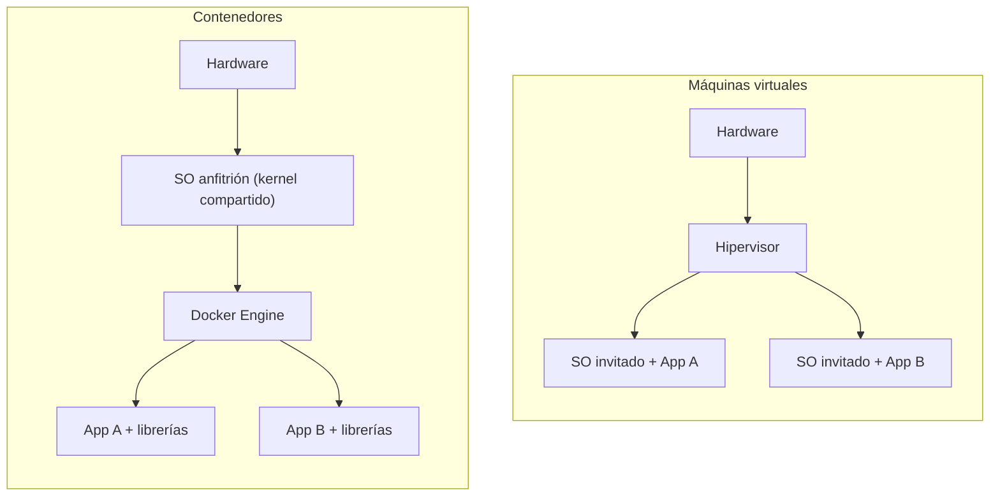

# Docker

## En simple

### La analogía que lo explica mejor

Montar un bar tiene dos caminos. **Opción A**: construir la cocina desde cero, instalar los fogones, conectar el gas, comprar los utensilios uno a uno. **Opción B**: pedir un módulo de cocina prefabricado, enchufarlo, y ya funciona.

**Docker es la opción B para software.** Cada programa viene empaquetado con todo lo que necesita (librerías, dependencias, configuración base). Se arranca con un comando y ya está corriendo, sin pelearse con "me falta tal librería" o "esta versión no es compatible".

### Diferencia con una máquina virtual

Una VM simula un ordenador entero, con su propio sistema operativo. Un contenedor **comparte el kernel** del equipo y solo empaqueta el programa y sus dependencias. Por eso es mucho más ligero y arranca en segundos.



---

## Conceptos clave

- **Imagen**: la plantilla de solo lectura, el plano del contenedor. Docker Hub tiene miles de imágenes públicas ya hechas (`cowrie/cowrie`, `grafana/grafana`, etc.): no se construyen desde cero, se descargan. Se identifican como `nombre:etiqueta` (por ejemplo `nginx:1.27`).
- **Contenedor**: una imagen puesta en marcha. Pueden coexistir varios contenedores de la misma imagen.
- **Volumen**: una carpeta que vive fuera del contenedor, en el disco real del equipo. Si el contenedor se reinicia o se borra, lo que esté en un volumen sobrevive.
- **Docker Compose**: un archivo que describe varios contenedores a la vez (imagen, puertos, volúmenes, conexiones). Con un solo comando se levantan todos.
- **Red Docker**: los contenedores de una misma red pueden hablarse usando su **nombre**, como un mini-DNS interno. Así, un servicio web y su base de datos se comunican sin buscar IPs.
- **Registro (registry)**: servidor donde se guardan las imágenes. El público por defecto es Docker Hub.
- **Dockerfile**: receta de texto para construir una imagen propia.

---

## En técnico

### Instalación (Debian/Ubuntu)

Método rápido para laboratorios, con el script oficial de conveniencia:

```bash
curl -fsSL https://get.docker.com | sh
sudo usermod -aG docker $USER      # usar docker sin sudo (cerrar sesión y volver a entrar)
docker --version
docker compose version
```

> Para entornos serios se recomienda instalar desde el repositorio apt oficial de Docker, siguiendo la guía de la documentación.

### Comandos básicos

| Comando | Para qué sirve |
|---|---|
| `docker pull nginx` | Descargar una imagen. |
| `docker images` | Listar imágenes locales. |
| `docker run -d --name web -p 8080:80 nginx` | Crear y arrancar un contenedor en segundo plano, publicando el puerto 8080 del equipo en el 80 del contenedor. |
| `docker ps` / `docker ps -a` | Contenedores en marcha / todos. |
| `docker logs -f web` | Ver los logs en directo. |
| `docker exec -it web sh` | Abrir una terminal dentro del contenedor. |
| `docker stop web` / `docker start web` | Parar / arrancar. |
| `docker rm web` | Borrar el contenedor (parado). |
| `docker rmi nginx` | Borrar la imagen. |
| `docker system prune` | Limpiar recursos sin usar. |

### Volúmenes

```bash
# Volumen gestionado por Docker
docker volume create datos
docker run -d --name db -v datos:/var/lib/mysql mariadb

# Bind mount: una carpeta concreta del equipo
docker run -d --name web -v /srv/web:/usr/share/nginx/html:ro -p 8080:80 nginx
```

Los datos que deben sobrevivir (bases de datos, logs, ficheros subidos) **siempre** en un volumen.

### Redes

```bash
docker network create mired
docker run -d --name db --network mired mariadb
docker run -d --name app --network mired miapp      # 'app' alcanza a 'db' por su nombre
docker network ls
docker network inspect mired
```

Tipos de red habituales: `bridge` (por defecto, red privada del host), `host` (comparte la red del equipo) y `none` (sin red).

### Dockerfile (imagen propia)

```dockerfile
FROM python:3.12-slim
WORKDIR /app
COPY requirements.txt .
RUN pip install --no-cache-dir -r requirements.txt
COPY . .
CMD ["python", "main.py"]
```

```bash
docker build -t miapp:1.0 .
```

### Docker Compose

Ejemplo con una web y su base de datos (`compose.yaml`):

```yaml
services:
  web:
    image: nginx:1.27
    ports:
      - "8080:80"
    depends_on:
      - db
    restart: unless-stopped

  db:
    image: mariadb:11
    environment:
      MARIADB_ROOT_PASSWORD: cambia-esta-clave
      MARIADB_DATABASE: ejemplo
    volumes:
      - datos-db:/var/lib/mysql
    restart: unless-stopped

volumes:
  datos-db:
```

```bash
docker compose up -d        # levantar todo en segundo plano
docker compose ps           # estado
docker compose logs -f      # logs
docker compose down         # parar y borrar contenedores (los volúmenes se conservan)
```

> En instalaciones antiguas el comando es `docker-compose` (con guion). Compose crea automáticamente una red para el proyecto, y los servicios se resuelven por nombre (`db`, `web`).

### Buenas prácticas y seguridad

- Fijar la **versión** de la imagen (`nginx:1.27`) en lugar de usar `latest`.
- No guardar contraseñas en el `compose.yaml` si el repositorio es público: usar un archivo `.env` fuera del control de versiones.
- No ejecutar contenedores en modo `--privileged` salvo que sea imprescindible.
- No exponer el socket de Docker (`/var/run/docker.sock`): da control total del equipo.
- Usar imágenes de fuentes fiables y mantenerlas actualizadas.

---

## Resumen

- Docker empaqueta software con todo lo necesario; las **imágenes** son plantillas y los **contenedores** son esas imágenes en ejecución.
- Los **volúmenes** conservan los datos; las **redes Docker** permiten que los contenedores se comuniquen por nombre.
- **Compose** define y levanta varios contenedores con un solo archivo.

## En HoneyNet

Los honeypots (Cowrie, Dionaea, DVWA) se desplegarán con un `docker compose`, y las herramientas de monitorización (Wazuh, Grafana) con otro. Los logs de Cowrie y las muestras de malware de Dionaea irán en volúmenes.

## Referencias

- Documentación oficial: <https://docs.docker.com/>
- Docker Hub: <https://hub.docker.com/>
- Referencia de Compose: <https://docs.docker.com/compose/>

[← Teoría](README.md)
