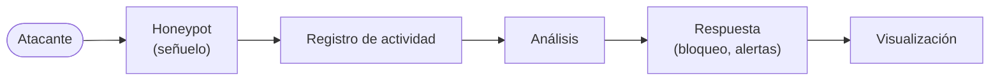

# Honeypots

## En simple

### Qué es un honeypot

Un **honeypot** (*tarro de miel*) es un sistema **señuelo**: un equipo o servicio que aparenta ser real y atractivo, pero que no tiene ningún valor productivo. Su único propósito es **ser atacado** para observar y registrar cómo actúan los atacantes.

> **Analogía:** una cartera falsa dejada a la vista con una cámara oculta. No importa lo que contenga; importa quién intenta cogerla y cómo.

Como nadie legítimo tiene motivo para usarlo, **todo el tráfico que recibe es sospechoso por definición**. Eso facilita mucho el análisis, ya que hay muy poco "ruido".

### Honeynet

Una **honeynet** es una **red entera** de honeypots (varios sistemas y servicios señuelo) junto con las herramientas para monitorizar y registrar lo que ocurre en ella.

### Para qué sirve

- Conocer **qué ataques** se reciben y desde dónde.
- Obtener **credenciales** probadas, comandos ejecutados y **malware**.
- **Alertar** de forma temprana (en una red interna, cualquier contacto con un honeypot indica un problema).
- **Investigar** y formar: estudiar técnicas de ataque en un entorno controlado.

---

## Conceptos clave

### Según el nivel de interacción

| Nivel | Qué hace | Ventaja | Riesgo |
|---|---|---|---|
| **Baja** | Emula servicios de forma superficial (puertos y respuestas básicas). | Seguro y fácil de montar. | Se detecta fácil; poca información. |
| **Media** | Emula un servicio de forma más completa (sistema de ficheros falso, comandos). | Equilibrio entre información y seguridad. | Un atacante hábil puede notar que es falso. |
| **Alta** | Es un sistema real, con servicios reales. | Información muy rica. | Si se compromete, es una máquina real al servicio del atacante. |

### Según el propósito

- **De producción**: protegen una organización alertando de intrusiones.
- **De investigación**: recogen información sobre amenazas para estudiarlas.

### Otros conceptos

- **Honeytoken**: dato señuelo (una credencial, un documento o un registro falso) que, si se usa, delata un acceso indebido.
- **Contención**: medidas para que un honeypot comprometido no sirva para atacar a terceros ni al resto de la red.
- **Aislamiento**: el señuelo va en una red separada de la red real.

### Riesgos y aspectos éticos y legales

- Un honeypot comprometido puede usarse como **plataforma de ataque** contra otros: hay que **limitar y vigilar el tráfico saliente**.
- No debe tener **ninguna conexión** con redes ni datos reales.
- Conviene conocer la **normativa** aplicable (por ejemplo, si se almacenan direcciones IP, que son datos personales) y, en entornos académicos o de empresa, contar con la autorización correspondiente.
- Hay que ser consciente de que los atacantes también pueden detectar honeypots.



---

## En técnico

### Cowrie (SSH y Telnet, interacción media)

**Qué hace.** Emula un servidor SSH y Telnet. El atacante cree que ha entrado en un sistema Linux real: Cowrie le ofrece una **terminal y un sistema de ficheros falsos**. Registra intentos de acceso (usuario y contraseña), comandos ejecutados y ficheros descargados.

- Escucha por defecto en el puerto **2222** (SSH) y **2223** (Telnet). Para recibir ataques en los puertos reales (22/23) se **redirige** el tráfico con el firewall o con la publicación de puertos de Docker. El SSH real de administración debe moverse a otro puerto.
- Los eventos se guardan en formato JSON (`cowrie.json`), con campos como `eventid` (`cowrie.login.failed`, `cowrie.command.input`...), `src_ip`, `username` y `password`.
- Puede configurarse qué credenciales "funcionan" (`userdb`) y qué aspecto tiene el sistema falso.

```bash
# Ejemplo con Docker (puerto 22 del equipo -> 2222 de Cowrie)
docker run -d --name cowrie -p 22:2222 cowrie/cowrie
docker logs -f cowrie
```

### Dionaea (malware, interacción baja)

**Qué hace.** Emula varios servicios vulnerables (entre ellos SMB, FTP, HTTP, MySQL, MSSQL y SIP) con el objetivo de **capturar malware** que intenta propagarse automáticamente. Los binarios descargados se guardan para su análisis, y los eventos se registran en una base de datos y en logs.

- Puertos típicos: 21 (FTP), 80/443 (HTTP/HTTPS), 445 (SMB), 1433 (MSSQL), 3306 (MySQL), 5060 (SIP).
- Las muestras capturadas se almacenan en una carpeta (por ejemplo, `binaries`) que conviene montar como **volumen**.

```bash
docker run -d --name dionaea -p 21:21 -p 445:445 -p 3306:3306 dinotools/dionaea
```

> **Las muestras de malware son peligrosas.** Nunca ejecutarlas, guardarlas en una máquina aislada y no abrirlas en un equipo personal.

### DVWA (aplicación web vulnerable)

**Qué es.** *Damn Vulnerable Web Application*: aplicación web en PHP/MySQL **intencionadamente vulnerable**, creada para practicar y estudiar ataques web. Tiene varios niveles de seguridad (`low`, `medium`, `high`, `impossible`).

Vulnerabilidades que permite trabajar: inyección SQL, XSS, ejecución de comandos, subida de ficheros, fuerza bruta de formularios, CSRF, etc.

Como señuelo, no captura malware, sino **técnicas de explotación web**: se registran las peticiones HTTP del atacante en los logs del servidor.

La forma recomendada de desplegarla es con el `compose` del repositorio oficial del proyecto (`digininja/DVWA`).

> DVWA es peligrosa por diseño: nunca debe exponerse en una red con datos o equipos reales.

### Comparativa

| | Cowrie | Dionaea | DVWA |
|---|---|---|---|
| Servicio | SSH / Telnet | SMB, FTP, HTTP, MySQL... | Web (HTTP) |
| Interacción | Media | Baja | Alta (app real vulnerable) |
| Captura | Credenciales, comandos, descargas | **Malware** | Técnicas de ataque web |
| Logs | JSON | Logs y base de datos | Logs del servidor web |

### Medidas de contención y buenas prácticas

- **Red aislada** (VLAN o bridge propio) sin acceso a la red interna real.
- **Firewall** que permita solo el tráfico entrante necesario y **limite o registre el saliente**.
- Ejecutar los honeypots en **contenedores** o VMs, con **límites de recursos** (CPU, memoria).
- **Snapshots** para volver a un estado limpio.
- **Enviar los logs fuera** del honeypot (a un SIEM) para que el atacante no pueda borrarlos.
- **Actualizar** el software del honeypot y vigilar que nadie lo use para atacar a terceros.

---

## Resumen

- Un honeypot es un señuelo cuyo tráfico es sospechoso por definición; una honeynet es una red de ellos con herramientas de monitorización.
- Se clasifican por nivel de interacción (baja, media, alta) y propósito (producción, investigación).
- **Cowrie** registra ataques SSH/Telnet, **Dionaea** captura malware y **DVWA** muestra ataques web.
- Es fundamental **aislar y contener** el señuelo.

## En HoneyNet

Los tres honeypots (Cowrie, Dionaea y DVWA) se despliegan con Docker en una zona aislada (DMZ), y sus logs se envían a la zona de gestión.

## Referencias

- The Honeynet Project: <https://www.honeynet.org/>
- Cowrie: <https://github.com/cowrie/cowrie>
- Dionaea: <https://github.com/DinoTools/dionaea>
- DVWA: <https://github.com/digininja/DVWA>

[← Teoría](README.md)
