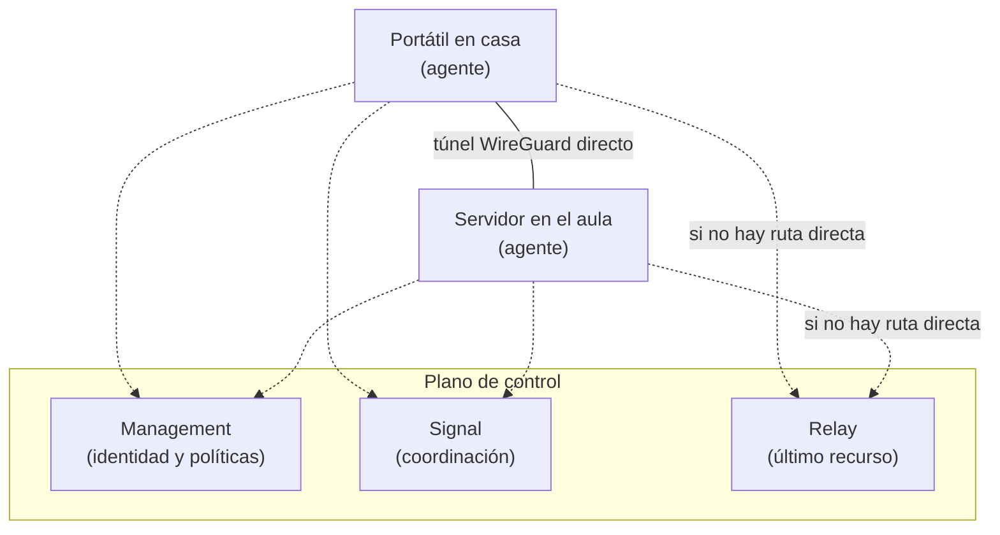

# NetBird

## En simple

### El problema que resuelve

Para entrar en una red desde fuera (por ejemplo, desde casa a un equipo del aula) tradicionalmente hay dos opciones: **abrir puertos** en el router (peligroso, porque quedan expuestos a Internet) o montar una **VPN clásica** con un servidor central por el que pasa todo el tráfico y que hay que configurar y mantener.

**NetBird** es una plataforma **open source** de **red privada superpuesta** (*overlay*) basada en **WireGuard®**. Cada dispositivo instala un pequeño agente, se identifica y pasa a formar parte de una **red privada cifrada** en la que todos se ven entre sí como si estuvieran en la misma red local, estén donde estén.

> **Analogía:** en lugar de abrir una puerta al público para que entre quien conozca la dirección, se entrega una llave personal a cada persona autorizada, y las conexiones entre ellas son túneles privados directos.

### Qué aporta

- **Sin abrir puertos** en el router ni exponer servicios a Internet.
- Conexiones **directas y cifradas** entre dispositivos (*peer-to-peer*) siempre que es posible.
- **Control de acceso**: se define quién puede hablar con quién.
- Inicio de sesión mediante **SSO** (Google, Microsoft, etc.) y MFA.
- Funciona en Linux, Windows, macOS, móviles, Docker y routers.
- Se puede usar su servicio en la nube o **autoalojarlo**.

---

## Conceptos clave

| Término | Significado |
|---|---|
| **Overlay** | Red virtual construida encima de la red real (Internet). |
| **WireGuard** | Protocolo de VPN moderno, rápido y con criptografía actual. |
| **Peer** | Cualquier dispositivo con el agente de NetBird instalado. |
| **Grupo** | Conjunto de peers o usuarios (`admins`, `servidores`...). |
| **Política de acceso** | Regla que define qué grupo puede comunicarse con cuál, y por qué puertos. |
| **Setup key** | Clave que registra un dispositivo sin iniciar sesión por navegador (útil en servidores). Puede caducar y ser de un solo uso. |
| **Network / ruta** | Permite que un peer dé acceso a una **subred entera** donde no se puede o no se quiere instalar el agente. |
| **Peer enrutador** | El peer que actúa de pasarela hacia esa subred. |
| **NAT traversal** | Técnica para conectar dos equipos que están detrás de routers con NAT. |
| **ZTNA** | *Zero Trust Network Access*: acceso basado en identidad y mínimo privilegio, y no en "estar dentro de la red". |

### Cómo se conectan los equipos



Los servidores de control **coordinan** a los dispositivos (quién es quién, qué políticas hay y cómo encontrarse), pero el tráfico de datos va **directo entre dispositivos** siempre que es posible. Solo si no se consigue una conexión directa (por ejemplo, por NAT restrictivos) se usa un **relay** como último recurso.

---

## En técnico

### Instalación del agente en Linux

```bash
curl -fsSL https://pkgs.netbird.io/install.sh | sh
sudo netbird up
```

`netbird up` muestra un enlace para autenticarse en el navegador. Una vez hecho, el dispositivo aparece en el panel de control (<https://app.netbird.io>) y recibe una IP de la red de NetBird.

> Comprueba siempre el comando vigente en la [documentación oficial](https://docs.netbird.io/), por si cambia.

### Registro sin navegador (servidores)

En el panel se crea una **setup key** y se usa:

```bash
sudo netbird up --setup-key <CLAVE>
```

### Comandos útiles

| Comando | Para qué sirve |
|---|---|
| `netbird status` | Estado de la conexión y de los peers. |
| `netbird status -d` | Estado detallado. |
| `netbird up` / `netbird down` | Conectar / desconectar. |
| `ip a show wt0` | Ver la interfaz de NetBird (se llama `wt0` en Linux). |

NetBird usa WireGuard sobre **UDP** (por defecto, el puerto 51820 local).

### Escenario típico: administrar un servidor del aula desde casa

1. **Instalar el agente** en el equipo del aula (o en una VM de administración) y en tu portátil.
2. Crear **grupos** (por ejemplo `admins` y `servidores`) y asignar los peers.
3. Crear una **política de acceso**: el grupo `admins` puede conectarse al grupo `servidores` solo por los puertos necesarios (SSH 22, interfaz web 8006...).
4. Conectarse usando la **IP de NetBird** del equipo:

```bash
ssh usuario@100.x.y.z                # IP de NetBird del servidor
# Navegador: https://100.x.y.z:8006
```

### Acceder a toda una subred con un peer enrutador

Si en el aula hay una red interna (por ejemplo `10.0.30.0/24`) y no se quiere instalar el agente en cada máquina:

1. Instalar el agente en **un equipo** que esté dentro de esa red.
2. En el panel, crear una **Network/ruta** hacia `10.0.30.0/24` que use ese equipo como peer enrutador.
3. Crear la política que permita a un grupo acceder a esa red.
4. En el equipo enrutador debe estar activado el reenvío de paquetes (`net.ipv4.ip_forward=1`).

> Los nombres exactos de los menús del panel pueden cambiar entre versiones; consultar la documentación.

### Autoalojado (*self-hosted*)

Se puede desplegar el plano de control en un servidor propio (normalmente con Docker) para no depender de la nube de NetBird. Requiere un servidor con IP pública, un dominio y un proveedor de identidad. La guía está en la documentación oficial (*Self-hosted quickstart*).

### Seguridad

- Aplicar **mínimo privilegio**: políticas por grupo, con los puertos justos.
- Activar **MFA** en el proveedor de identidad.
- Dar **caducidad** a las setup keys y eliminarlas cuando no se usen.
- Revisar el **registro de actividad** del panel.
- No instalar el agente en máquinas poco fiables que puedan quedar comprometidas: tendrían un pie dentro de la red privada.

### NetBird frente a una VPN clásica

| | VPN clásica (servidor central) | NetBird |
|---|---|---|
| Tráfico | Pasa por el servidor VPN | Directo entre dispositivos (con relay de respaldo) |
| Punto único de fallo | Sí, el servidor VPN | No para el tráfico de datos |
| Puertos abiertos en el router | Normalmente sí | No hace falta |
| Control de acceso | Suele ser por red | Por grupos y políticas |
| Mantenimiento | Manual | Gestión desde un panel |

---

## Resumen

- NetBird crea una red privada cifrada entre dispositivos usando WireGuard, sin abrir puertos.
- Los dispositivos (*peers*) se organizan en grupos y las políticas definen quién accede a qué.
- Un *peer* enrutador puede dar acceso a toda una subred.
- Es ideal para administrar equipos remotos de forma segura.

## En HoneyNet

HoneyNet administra a distancia la infraestructura de forma segura con NetBird, sin abrir ningún puerto de administración a Internet. En el laboratorio, se usa para conectarse desde casa al PC con Proxmox situado en el aula.

## Referencias

- Web oficial: <https://netbird.io/>
- Documentación: <https://docs.netbird.io/>
- WireGuard: <https://www.wireguard.com/>

[← Teoría](README.md)
