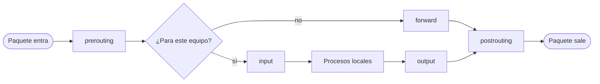

# nftables

## En simple

### Qué es un firewall de Linux

El kernel de Linux incluye un sistema que inspecciona cada paquete de red que entra, sale o atraviesa el equipo, y decide qué hacer con él: dejarlo pasar, descartarlo, modificarlo o registrarlo. **nftables** es el framework moderno que controla ese sistema y el **sucesor de iptables**.

> **Analogía:** un portero con una lista de instrucciones muy ordenada. Cada paquete que llega es una persona; el portero recorre la lista de arriba abajo y aplica la primera norma que le corresponde.

### Por qué nftables y no iptables

- **Una sola herramienta y sintaxis** para IPv4, IPv6 y otros protocolos (la familia `inet` agrupa IPv4 e IPv6).
- Reglas **más legibles**.
- **Conjuntos (*sets*)** y mapas: agrupar muchas IPs o puertos sin repetir reglas.
- Los cambios se cargan **de forma atómica** (todo o nada).
- Mejor rendimiento con muchas reglas.

En distribuciones actuales como Debian, nftables es el sistema por defecto; los comandos `iptables` clásicos suelen ser una capa de compatibilidad sobre nftables.

---

## Conceptos clave

| Elemento | Qué es |
|---|---|
| **Tabla** | Contenedor de cadenas. Tiene una **familia**: `ip`, `ip6`, `inet` (ambas), `arp`, `bridge`, `netdev`. |
| **Cadena** | Lista ordenada de reglas. Una **cadena base** se engancha (*hook*) a un punto del recorrido del paquete. |
| **Regla** | Condiciones (qué paquete) + acción (qué hacer). |
| **Set** | Colección de IPs, puertos, redes... reutilizable en reglas. |
| **Política (`policy`)** | Acción por defecto de una cadena base cuando ninguna regla coincide (`accept` o `drop`). |

A diferencia de iptables, **no existen tablas ni cadenas predefinidas**: las creas tú.

### Puntos de enganche (hooks)

| Hook | Cuándo actúa | Uso típico |
|---|---|---|
| `prerouting` | Nada más entrar el paquete, antes de decidir su ruta. | DNAT. |
| `input` | Paquetes destinados al propio equipo. | Proteger el equipo. |
| `forward` | Paquetes que **atraviesan** el equipo hacia otra red. | Filtrar tráfico entre redes (router). |
| `output` | Paquetes que genera el propio equipo. | Limitar la salida. |
| `postrouting` | Justo antes de salir. | SNAT / masquerade. |



### Acciones habituales

`accept`, `drop` (descarta sin avisar), `reject` (descarta y avisa), `log`, `counter`, `limit`, `dnat to`, `snat to`, `masquerade`, `jump`.

### Seguimiento de conexiones (*conntrack*)

`ct state` clasifica los paquetes: `new` (inicio de conexión), `established` (parte de una conexión ya abierta), `related` (relacionada con una existente) e `invalid`. Permitir `established,related` es lo que hace el firewall *stateful*: las respuestas pasan automáticamente.

---

## En técnico

### Instalación y servicio

```bash
sudo apt install nftables
sudo systemctl enable --now nftables      # carga /etc/nftables.conf al arrancar
```

### Comandos útiles

| Comando | Para qué sirve |
|---|---|
| `sudo nft list ruleset` | Ver todas las reglas activas. |
| `sudo nft list table inet filter` | Ver una tabla concreta. |
| `sudo nft -c -f /etc/nftables.conf` | **Comprobar** la sintaxis sin aplicar. |
| `sudo nft -f /etc/nftables.conf` | Cargar el fichero. |
| `sudo nft flush ruleset` | Borrar todas las reglas. |
| `sudo nft add rule inet filter input tcp dport 80 accept` | Añadir una regla al vuelo. |
| `sudo nft -a list ruleset` | Ver las reglas con su *handle* (para borrarlas). |
| `sudo nft delete rule inet filter input handle 7` | Borrar una regla por su handle. |

Las reglas añadidas con `nft` están en memoria; para que sobrevivan al reinicio deben estar en `/etc/nftables.conf`.

### Ejemplo 1: firewall de un equipo (servidor)

```nft
#!/usr/sbin/nft -f
flush ruleset

table inet filter {
    chain input {
        type filter hook input priority 0; policy drop;

        iif "lo" accept
        ct state established,related accept
        ct state invalid drop

        ip protocol icmp accept
        ip6 nexthdr icmpv6 accept

        tcp dport 22 ct state new limit rate 5/minute accept   # SSH con límite
        tcp dport { 80, 443 } accept                          # web
    }

    chain forward {
        type filter hook forward priority 0; policy drop;
    }

    chain output {
        type filter hook output priority 0; policy accept;
    }
}
```

> **Cuidado al trabajar por SSH:** una política `drop` en `input` sin permitir el puerto 22 te deja fuera. Probar siempre con `nft -c` y tener acceso por consola.

### Ejemplo 2: router con NAT

Para que el equipo reenvíe paquetes hay que activar el *forwarding*:

```bash
echo "net.ipv4.ip_forward=1" | sudo tee /etc/sysctl.d/99-forward.conf
sudo sysctl --system
```

```nft
table inet filter {
    chain forward {
        type filter hook forward priority 0; policy drop;
        ct state established,related accept
        iifname "ens19" oifname "ens18" accept        # red interna -> exterior
    }
}

table ip nat {
    chain prerouting {
        type nat hook prerouting priority -100;
        # Redirigir el puerto 8080 del exterior a un servidor interno
        iifname "ens18" tcp dport 8080 dnat to 10.0.10.10:80
    }
    chain postrouting {
        type nat hook postrouting priority 100;
        oifname "ens18" masquerade
    }
}
```

Para que el tráfico redirigido llegue, la regla de `forward` debe permitirlo (por ejemplo `ip daddr 10.0.10.10 tcp dport 80 accept`).

### Sets: agrupar IPs y puertos

```nft
table inet filter {
    set permitidas {
        type ipv4_addr
        flags interval
        elements = { 192.168.1.0/24, 10.0.30.0/24 }
    }

    chain input {
        type filter hook input priority 0; policy drop;
        ct state established,related accept
        ip saddr @permitidas tcp dport 22 accept
    }
}
```

### Lista negra dinámica con caducidad

```nft
table inet filter {
    set bloqueadas {
        type ipv4_addr
        flags timeout
    }
    chain input {
        type filter hook input priority -10; policy accept;
        ip saddr @bloqueadas drop
    }
}
```

```bash
# Bloquear una IP durante 1 hora
sudo nft add element inet filter bloqueadas { 203.0.113.5 timeout 1h }
```

### Registro (*logging*) y contadores

```nft
chain input {
    type filter hook input priority 0; policy drop;
    ct state established,related accept
    tcp dport 22 accept
    # Registrar (con límite) lo que se va a descartar
    limit rate 5/minute log prefix "NFT-DROP: " counter drop
}
```

Los registros del `log` salen en el log del kernel: `journalctl -k | grep NFT-DROP`.

### Migrar desde iptables

```bash
iptables-save | iptables-restore-translate -f -     # traduce un ruleset completo
iptables-translate -A INPUT -p tcp --dport 22 -j ACCEPT
```

### Buenas prácticas

- Política **`drop` por defecto** y permitir solo lo necesario.
- Permitir primero `established,related`: es lo más frecuente y acelera el procesamiento.
- **Comprobar con `nft -c`** antes de aplicar.
- Mantener las reglas en `/etc/nftables.conf` bajo control de versiones.
- Usar sets en lugar de repetir reglas.

---

## Resumen

- nftables es el firewall del kernel de Linux y reemplaza a iptables.
- Se organiza en **tablas → cadenas → reglas**, y las cadenas base se enganchan a *hooks* (`input`, `forward`, `output`, `prerouting`, `postrouting`).
- Soporta NAT, sets, límites de ritmo, registro y listas dinámicas con caducidad.
- La buena práctica es denegar por defecto y permitir explícitamente.

## En HoneyNet

nftables puede actuar como firewall de cada máquina Linux de la solución (por ejemplo, para que una VM solo acepte el tráfico que necesita), como capa adicional al firewall de red.

## Referencias

- Wiki oficial: <https://wiki.nftables.org/>
- `man nft`

[← Teoría](README.md)
