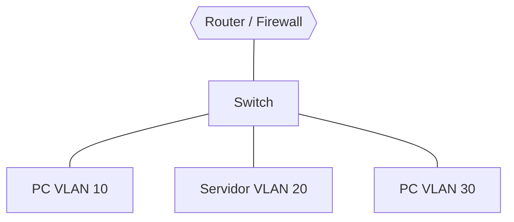
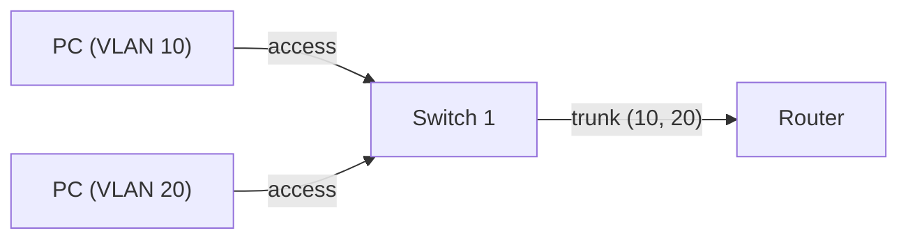

# VLANs

## En simple

### Qué es una VLAN

Una **VLAN** (*Virtual Local Area Network*) es una red local **virtual**: permite dividir una misma infraestructura física (un switch, un cable) en varias redes lógicas independientes. Los equipos de una VLAN no ven el tráfico de otra, aunque estén enchufados al mismo switch.

> **Analogía:** un edificio de oficinas con una sola entrada. Cada empresa tiene su planta y su llave: comparten el edificio (el cable), pero no pueden entrar en las plantas de las demás.

### Para qué sirve

- **Seguridad**: separar zonas con distinto nivel de riesgo (invitados, servidores, gestión...).
- **Rendimiento**: reduce el tráfico de *broadcast*, porque cada VLAN es un dominio de broadcast distinto.
- **Orden y flexibilidad**: se agrupan equipos por función y no por ubicación física.

### Sin enrutador no hay comunicación

Dos VLANs distintas son redes distintas. Para que se comuniquen hace falta un dispositivo de nivel 3 (un router, un firewall o un switch L3). Ese punto es justo donde se pueden **aplicar reglas** sobre qué tráfico se permite.



---

## Conceptos clave

- **VLAN ID (VID)**: número que identifica la VLAN, de 1 a 4094 (el campo tiene 12 bits; 0 y 4095 están reservados).
- **802.1Q**: estándar que añade una **etiqueta (tag)** de 4 bytes a la trama Ethernet con el VID.
- **Puerto de acceso (*access*)**: pertenece a una sola VLAN; los equipos conectados no saben que existen las VLANs (las tramas salen sin etiqueta).
- **Puerto troncal (*trunk*)**: transporta **varias VLANs** a la vez con sus etiquetas. Se usa entre switches o entre un switch y un router/hipervisor.
- **VLAN nativa**: VLAN cuyas tramas viajan **sin etiqueta** por un trunk (por defecto, la 1).
- **Enrutado entre VLANs (*inter-VLAN routing*)**: un router o firewall conecta las VLANs y decide qué tráfico pasa.
- **Router-on-a-stick**: un único enlace trunk hacia un router, que tiene una subinterfaz por VLAN.
- **Defensa en profundidad**: usar varias capas de protección, de modo que si una falla la siguiente sigue protegiendo.



---

## En técnico

### Estructura de una trama 802.1Q

La etiqueta de 4 bytes se inserta en la trama Ethernet y contiene:

| Campo | Tamaño | Función |
|---|---|---|
| TPID | 16 bits | Valor `0x8100`: indica que la trama lleva etiqueta. |
| PCP | 3 bits | Prioridad (QoS). |
| DEI | 1 bit | Elegibilidad de descarte. |
| VID | 12 bits | Identificador de la VLAN. |

### Configuración en un switch (sintaxis estilo Cisco)

```
vlan 10
 name DMZ
vlan 20
 name SERVIDORES

interface GigabitEthernet0/1
 switchport mode access
 switchport access vlan 10

interface GigabitEthernet0/24
 switchport mode trunk
 switchport trunk allowed vlan 10,20
```

### Enrutado entre VLANs (router-on-a-stick)

```
interface GigabitEthernet0/0.10
 encapsulation dot1Q 10
 ip address 10.0.10.1 255.255.255.0
interface GigabitEthernet0/0.20
 encapsulation dot1Q 20
 ip address 10.0.20.1 255.255.255.0
```

### VLANs en Linux

```bash
ip link add link eth0 name eth0.10 type vlan id 10
ip addr add 10.0.10.2/24 dev eth0.10
ip link set eth0.10 up
ip -d link show eth0.10        # ver detalles de la VLAN
```

### VLANs en Proxmox

Se activa el modo *VLAN-aware* en el bridge (`bridge-vlan-aware yes`) y después se indica la etiqueta en la interfaz de red de cada VM (*VLAN Tag*). Una VM con firewall (como pfSense) puede recibir varias VLANs por un solo enlace trunk. Más detalle en [Proxmox](proxmox.md).

### Plan de direccionamiento: buena práctica

Relacionar el número de VLAN con la red facilita el mantenimiento:

| VLAN | Nombre | Red |
|---|---|---|
| 10 | DMZ | 10.0.10.0/24 |
| 20 | Servidores | 10.0.20.0/24 |
| 30 | Gestión | 10.0.30.0/24 |
| 40 | Usuarios | 10.0.40.0/24 |

### Ataques y mitigaciones

| Ataque | Cómo funciona | Mitigación |
|---|---|---|
| **Switch spoofing** | Un equipo finge ser un switch para negociar un trunk y ver todas las VLANs. | Desactivar la negociación (DTP) y fijar los puertos como *access*. |
| **Doble etiquetado (VLAN hopping)** | Se envía una trama con dos etiquetas para saltar a otra VLAN a través de la VLAN nativa. | No usar la VLAN 1 como nativa y no asignar equipos a la VLAN nativa. |
| **Puertos sin usar** | Un puerto libre abre una entrada a la red. | Apagarlos y asignarlos a una VLAN sin uso. |

> Las VLANs **segmentan**, pero no sustituyen a un firewall: lo que protege de verdad es el filtrado en el punto donde se enrutan.

---

## Resumen

- Una VLAN divide una red física en redes lógicas aisladas entre sí.
- Los puertos **access** llevan una VLAN; los **trunk** llevan varias, etiquetadas con 802.1Q.
- Para comunicar VLANs hace falta enrutado, y ahí se aplican las reglas de firewall.
- Un buen diseño relaciona VLAN, nombre y red, y evita la VLAN nativa por defecto.

## En HoneyNet

HoneyNet segmenta la red del cliente en cinco VLANs (exterior, DMZ, servidores, gestión y usuarios), cada una con su propósito, para que un honeypot comprometido quede aislado del resto. Ver el [diagrama de red](../Introducci%C3%B3n/diagrama-de-red.md).

## Referencias

- IEEE 802.1Q (estándar)
- Documentación de Proxmox: <https://pve.proxmox.com/wiki/Network_Configuration>

[← Teoría](README.md)
