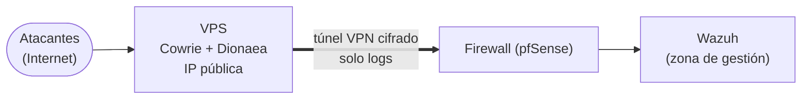

# VPS y túneles VPN

## En simple

### Qué es una VPS

Una **VPS** (*Virtual Private Server*) es un servidor virtual que se **alquila** a un proveedor de la nube. Tiene su propia **IP pública**, se contrata por meses o por horas, y se puede crear, destruir y recrear fácilmente.

> **Analogía:** en lugar de poner el señuelo en el salón de tu casa, lo dejas en un local alquilado en otra calle. Si lo destrozan, no pierdes tu casa.

### Por qué poner los honeypots en una VPS

Para capturar **ataques reales** hay que exponer los honeypots a Internet. Hacerlo desde una red propia (de un centro, una oficina o una casa) tiene riesgos y, además, no siempre se controla el router de esa red. Una VPS resuelve el problema:

- **Aísla:** los atacantes llegan a la VPS, no a la red real.
- **Tiene IP pública** propia y limpia, sin tocar el router de la red local.
- Es **desechable**: si se compromete, se destruye y se vuelve a crear.

### Qué es un túnel VPN

Un **túnel VPN** es una conexión **cifrada** entre dos puntos que atraviesa Internet como si fuera un cable privado. Lo que viaja dentro del túnel no puede leerse ni modificarse por el camino.

En este escenario el túnel conecta la VPS con la red de monitorización, para que los **logs** de los honeypots lleguen al SIEM **sin abrir puertos** en la red.



---

## Conceptos clave

| Término | Significado |
|---|---|
| **VPS** | Servidor virtual alquilado en la nube, con IP pública. |
| **Túnel VPN** | Conexión cifrada entre dos puntos a través de Internet. |
| **WireGuard** | Protocolo de VPN moderno, ligero y rápido. |
| **OpenVPN** | Protocolo de VPN clásico y muy extendido. |
| **Cliente / servidor VPN** | Quien inicia el túnel / quien lo espera. |
| **NAT traversal** | Capacidad de un túnel de funcionar a través de routers con NAT. |
| **Keepalive** | Mensajes periódicos que mantienen el túnel abierto. |
| **Mínimo privilegio** | Permitir por el túnel solo lo estrictamente necesario. |

### La idea clave: el túnel lo abre el firewall hacia fuera

El túnel se **inicia desde dentro** de la red (el firewall se conecta a la VPS). Como es una conexión **saliente**, funciona aunque el router de la red local **no abra ningún puerto** hacia dentro. Así la red queda aislada de Internet y, aun así, recibe los registros.

---

## En técnico

### Preparar la VPS

Una VPS expuesta a ataques reales debe tratarse como **hostil**:

- **SSH real** en otro puerto, solo con **claves** (sin contraseña) y limitado a tu IP.
- Un **firewall** que permita solo lo necesario: los puertos señuelo hacia fuera y el túnel.
- Los **contenedores** de los honeypots, con **límites de recursos** y sin poder iniciar conexiones hacia fuera salvo lo imprescindible.
- **Sin secretos** valiosos guardados en ella.
- **Snapshots o imagen** para recrearla rápidamente.
- Proveedores habituales para laboratorios: Hetzner y similares.

### Ejemplo de túnel con WireGuard

Lado de la VPS (`/etc/wireguard/wg0.conf`):

```ini
[Interface]
Address    = 10.99.0.1/24
ListenPort = 51820
PrivateKey = <clave privada de la VPS>

[Peer]
PublicKey  = <clave pública del firewall>
AllowedIPs = 10.99.0.2/32
```

Lado del firewall (la configuración se hace desde la interfaz web de pfSense, con estos datos):

```ini
[Interface]
Address    = 10.99.0.2/24
PrivateKey = <clave privada del firewall>

[Peer]
PublicKey           = <clave pública de la VPS>
Endpoint            = <IP pública de la VPS>:51820
AllowedIPs          = 10.99.0.1/32
PersistentKeepalive = 25
```

```bash
# Generar un par de claves
wg genkey | tee privada.key | wg pubkey > publica.key

# En la VPS
sudo wg-quick up wg0
sudo wg show               # estado del túnel
```

`PersistentKeepalive` mantiene el túnel abierto aunque no haya tráfico, algo importante cuando el firewall está detrás de un NAT.

### Que los logs lleguen al SIEM

Para que el agente de Wazuh de la VPS alcance al servidor Wazuh a través del túnel:

1. La VPS debe **saber llegar** a la IP del servidor Wazuh por el túnel (en WireGuard, incluyéndola en los `AllowedIPs` o mediante rutas/NAT).
2. En el firewall se crea **una única regla**: tráfico del túnel hacia el servidor Wazuh, **solo los puertos 1514 y 1515**.
3. Todo lo demás que llegue por el túnel se **bloquea**.

> Es el principio de **mínimo privilegio** aplicado al túnel: por él solo viajan los logs, y desde la VPS no se puede alcanzar nada más de la red.

### Comprobaciones

```bash
sudo wg show                          # ¿hay un "latest handshake" reciente?
ping 10.99.0.2                        # desde la VPS, ¿responde el firewall?
sudo ss -tn | grep 1514               # desde la VPS, ¿hay conexión con Wazuh?
```

Si no funciona, se diagnostica **capa por capa**: ¿el túnel está arriba?, ¿la ruta existe?, ¿la regla de firewall permite el puerto?

### Buenas prácticas

- **Limitar** lo que pasa por el túnel con reglas explícitas y registro.
- **Rotar claves** si hay sospecha de que se han expuesto.
- **Vigilar el túnel** y avisar si se cae.
- **Tener un plan de recreación** de la VPS en caso de compromiso.
- Respetar los **términos del proveedor** y la normativa sobre el tráfico de los honeypots.

---

## Resumen

- Una **VPS** en la nube permite recibir ataques reales sin exponer la red propia.
- Un **túnel VPN** cifrado, abierto desde dentro, transporta solo los logs hasta el SIEM sin abrir puertos.
- La VPS se trata como un sistema **hostil y desechable**; el túnel, con **mínimo privilegio**.

## En HoneyNet

Esta tecnología **no forma parte del diseño actual**: el laboratorio no se expone a Internet y los ataques los genera Kali dentro de la red. Se mantiene aquí como teoría y como posible ampliación futura (capturar ataques reales sin exponer la red).

## Referencias

- WireGuard: <https://www.wireguard.com/>
- Documentación de pfSense: <https://docs.netgate.com/pfsense/en/latest/>
- Cowrie: <https://github.com/cowrie/cowrie>

[← Teoría](README.md)
