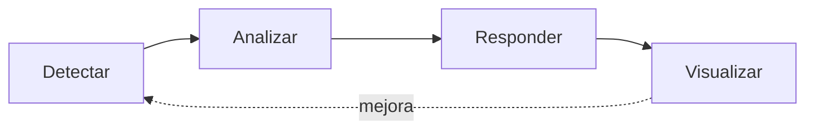
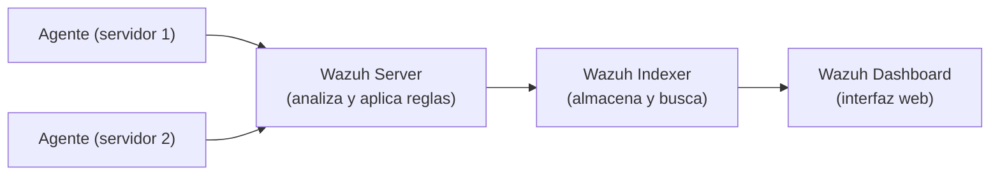

# Monitorización y respuesta: Wazuh, Grafana y alertas

## En simple

### Por qué hace falta

Cada sistema genera **logs** (registros de lo que ocurre). Con pocos equipos se pueden leer a mano, pero cuando hay muchos, es imposible. Hace falta algo que los **recoja en un sitio, los analice y avise** cuando ocurre algo raro.

Un proceso completo de seguridad suele seguir estos pasos:



### SIEM

Un **SIEM** (*Security Information and Event Management*) **centraliza** los logs de muchos sistemas, los **correlaciona** (relaciona eventos que por separado parecen inofensivos) y genera **alertas**.

> **Analogía:** la sala de control de seguridad de un edificio, donde llegan las imágenes de todas las cámaras, y hay una persona (o un sistema) mirando todas las pantallas a la vez y avisando si algo no cuadra.

### Qué es Wazuh

**Wazuh** es una plataforma de seguridad **open source** que combina funciones de SIEM y de detección en los equipos (XDR/HIDS). Instala un **agente** en cada máquina que envía información a un servidor central.

Funciones principales:

- **Análisis de logs** y correlación mediante reglas.
- **Integridad de ficheros** (FIM): avisa si cambian ficheros importantes.
- **Detección de vulnerabilidades** del software instalado.
- **Evaluación de configuración** (comparando con buenas prácticas).
- **Respuesta activa**: acciones automáticas, como bloquear una IP.

### Qué es Grafana

**Grafana** es una herramienta de **visualización**. Se conecta a distintas fuentes de datos (bases de datos, motores de búsqueda, métricas...) y construye **paneles (dashboards)** con gráficos, tablas y mapas. También puede enviar **alertas**.

---

## Conceptos clave

| Término | Significado |
|---|---|
| **Log** | Registro de un evento (un acceso, un error, una petición...). |
| **Agente** | Programa instalado en cada equipo que envía logs al servidor. |
| **Decodificador (*decoder*)** | Extrae campos (IP, usuario, acción) de una línea de log. |
| **Regla** | Condición sobre eventos que genera una alerta, con un nivel de gravedad. |
| **Correlación** | Relacionar varios eventos (por ejemplo, 10 fallos de login seguidos de un éxito). |
| **Falso positivo** | Alerta que salta sin que haya un ataque real. |
| **Dashboard** | Panel visual con gráficos y datos. |
| **Fuente de datos** | Origen de los datos que consulta Grafana. |
| **Respuesta activa** | Acción automática ante una alerta. |
| **Threat intelligence** | Información sobre amenazas conocidas (por ejemplo, IPs maliciosas). |

---

## En técnico

### Arquitectura de Wazuh



- **Wazuh Server**: recibe los datos de los agentes, los analiza con decodificadores y reglas.
- **Wazuh Indexer**: almacena e indexa las alertas (basado en OpenSearch).
- **Wazuh Dashboard**: interfaz web para consultar y gestionar.
- **Agentes**: se comunican con el servidor por los puertos **1514** (eventos) y **1515** (registro); el servidor expone una API en el **55000**.

### Instalación

Para entornos pequeños, Wazuh ofrece un asistente de instalación "todo en uno" que despliega servidor, indexer y dashboard en una sola máquina. La URL del script depende de la versión vigente, así que hay que copiarla de la **guía oficial de instalación**:

```bash
curl -sO https://packages.wazuh.com/<versión>/wazuh-install.sh
sudo bash ./wazuh-install.sh -a
```

Requiere recursos considerables (varios GB de RAM); se recomienda consultar los requisitos de la documentación. Al final muestra la URL y las credenciales del dashboard.

### Instalar agentes

Desde el dashboard (*Agents → Deploy new agent*) se genera el comando de instalación para cada sistema operativo. El agente se registra contra el servidor y empieza a enviar datos.

### Recoger logs de otros programas

En el agente se indica qué ficheros leer, en `/var/ossec/etc/ossec.conf`:

```xml
<localfile>
  <log_format>json</log_format>
  <location>/ruta/al/log.json</location>
</localfile>
```

### Reglas personalizadas

Las reglas propias se escriben en `/var/ossec/etc/rules/local_rules.xml`. Ejemplo conceptual de una regla que avisa de varios fallos de login seguidos:

```xml
<group name="ejemplo,">
  <rule id="100100" level="10" frequency="8" timeframe="120">
    <if_matched_sid>5716</if_matched_sid>
    <same_srcip />
    <description>Posible fuerza bruta: varios fallos de SSH desde la misma IP</description>
  </rule>
</group>
```

Tras editar las reglas: `sudo systemctl restart wazuh-manager`. Se pueden probar con la herramienta `wazuh-logtest`.

### Grafana

Instalación rápida con Docker:

```bash
docker run -d --name grafana -p 3000:3000 -v grafana-data:/var/lib/grafana grafana/grafana
```

Acceso: `http://IP:3000` (usuario y contraseña iniciales `admin`/`admin`; se pide cambiarla al entrar).

Pasos básicos:

1. **Connections → Data sources → Add**: elegir el origen (MySQL/MariaDB, OpenSearch...).
2. **Dashboards → New**: crear paneles con consultas, por ejemplo:

```sql
SELECT ip_origen, COUNT(*) AS intentos
FROM eventos
GROUP BY ip_origen
ORDER BY intentos DESC
LIMIT 10;
```

3. Tipos de panel útiles: series temporales, barras, tablas y **Geomap** (mapa de origen de los ataques).

### Alertas por Telegram

1. En Telegram, hablar con **@BotFather**, crear un bot (`/newbot`) y guardar el **token**.
2. Escribir al bot y obtener el **chat ID** (por ejemplo, consultando `https://api.telegram.org/bot<TOKEN>/getUpdates`).
3. En Grafana: **Alerting → Contact points → Add**, tipo **Telegram**, con el token y el chat ID.
4. Crear una **regla de alerta** sobre una consulta (por ejemplo, "más de 50 intentos en 5 minutos") y asignarle ese contact point.

Prueba rápida desde la terminal:

```bash
curl -s "https://api.telegram.org/bot<TOKEN>/sendMessage" \
     -d chat_id=<CHAT_ID> -d text="Prueba de alerta"
```

> El token es una credencial: no subirlo a un repositorio público.

### Script de respuesta (opcional): enriquecer IPs con AbuseIPDB

**AbuseIPDB** es una base de datos colaborativa que puntúa la reputación de una IP. Su API permite consultar si una IP ha sido denunciada (hay un límite diario de consultas en el plan gratuito).

Ejemplo en Python que lee un log JSON, consulta cada IP y guarda el resultado:

```python
#!/usr/bin/env python3
import json
import os
import requests

API_KEY = os.environ["ABUSEIPDB_KEY"]          # no escribir la clave en el código
LOG = "/ruta/al/log.json"

def reputacion(ip):
    r = requests.get(
        "https://api.abuseipdb.com/api/v2/check",
        headers={"Key": API_KEY, "Accept": "application/json"},
        params={"ipAddress": ip, "maxAgeInDays": 90},
        timeout=10,
    )
    r.raise_for_status()
    return r.json()["data"]["abuseConfidenceScore"]

vistas = set()
with open(LOG) as f:
    for linea in f:
        try:
            ev = json.loads(linea)
        except json.JSONDecodeError:
            continue
        ip = ev.get("src_ip")
        if ip and ip not in vistas:
            vistas.add(ip)
            print(ip, reputacion(ip))
            # Aquí: guardar en la base de datos o lanzar el bloqueo
```

Para **bloquear** la IP desde el script, las opciones habituales son añadirla a una lista del firewall (por ejemplo, un *set* de nftables con caducidad, ver [nftables](nftables.md)) o usar la **respuesta activa** de Wazuh. Conviene empezar solo avisando y activar el bloqueo automático cuando las reglas estén bien ajustadas, para evitar bloquear tráfico legítimo.

### Buenas prácticas

- **Ajustar las reglas** para reducir falsos positivos; una herramienta que avisa de todo acaba ignorándose.
- **Retención de logs**: decidir cuánto tiempo se guardan y vigilar el espacio en disco.
- **Sincronizar la hora** (NTP) en todos los equipos: sin hora correcta no se pueden correlacionar eventos.
- Enviar los logs a otra máquina para que un atacante no pueda borrar las huellas.
- Proteger con **mínimo privilegio** el acceso al SIEM y a los paneles.

---

## Resumen

- Un **SIEM** centraliza y correlaciona logs; **Wazuh** lo hace con agentes, un servidor, un indexer y un dashboard.
- **Grafana** visualiza datos y envía alertas (por ejemplo a Telegram).
- De forma opcional, un script puede **enriquecer** las IPs con servicios como AbuseIPDB y desencadenar respuestas.
- El ciclo completo es **detectar → analizar → responder → visualizar**.

## En HoneyNet

Wazuh (completo: manager, indexador y panel) y Grafana se despliegan con Docker en la **VM del SIEM** (PC 2, VLAN 30). Los agentes de Wazuh están en la VM de honeypots, en los servidores y en el servidor web. **Los ataques se guardan en Wazuh** y Grafana los muestra; los paneles se incrustan en la zona de administración de la web (`/admin`) a través de un proxy de nginx, y las alertas llegan a Telegram **sin escribir código**. El script de respuesta y el bloqueo automático de IPs son un extra opcional.

## Referencias

- Wazuh: <https://documentation.wazuh.com/>
- Grafana: <https://grafana.com/docs/>
- AbuseIPDB API: <https://docs.abuseipdb.com/>
- Telegram Bot API: <https://core.telegram.org/bots/api>

[← Teoría](README.md)
